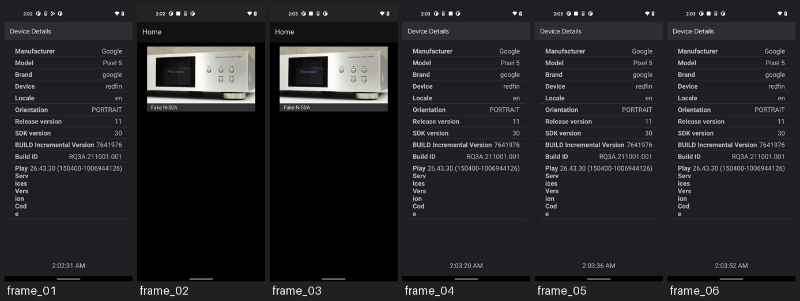
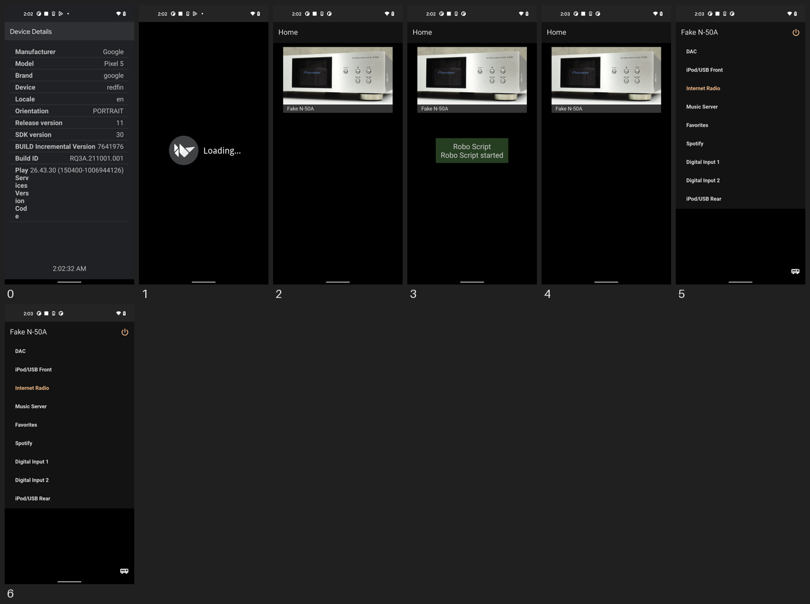
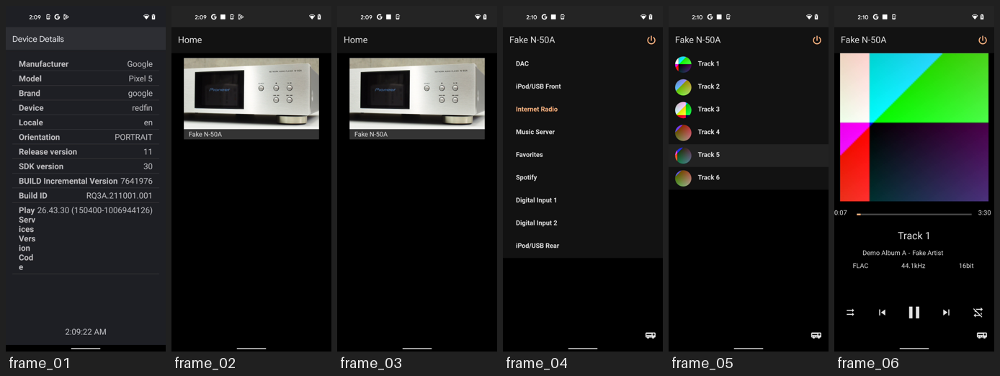
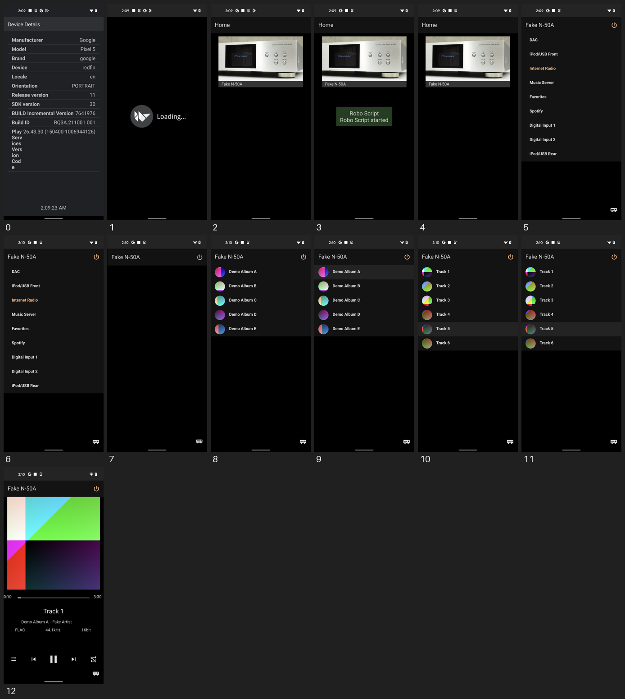
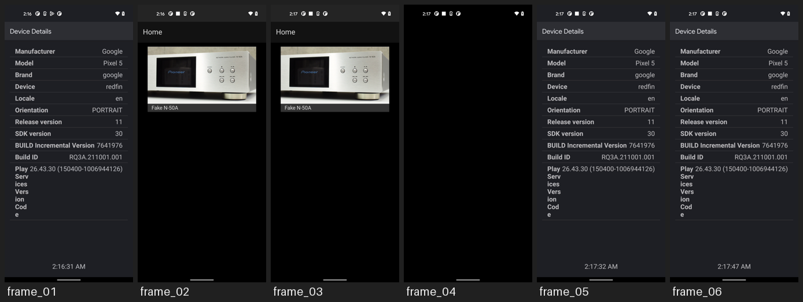
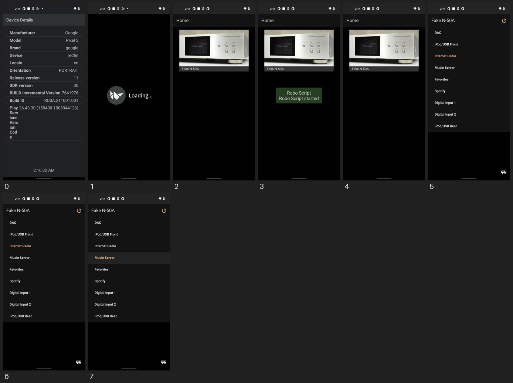
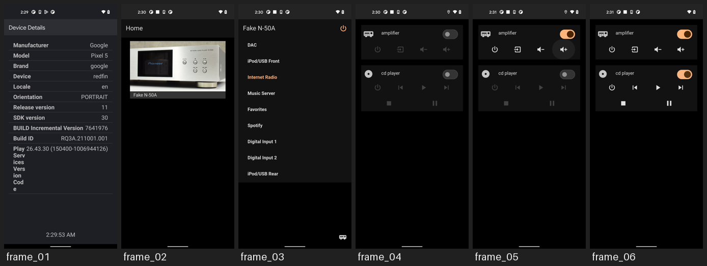
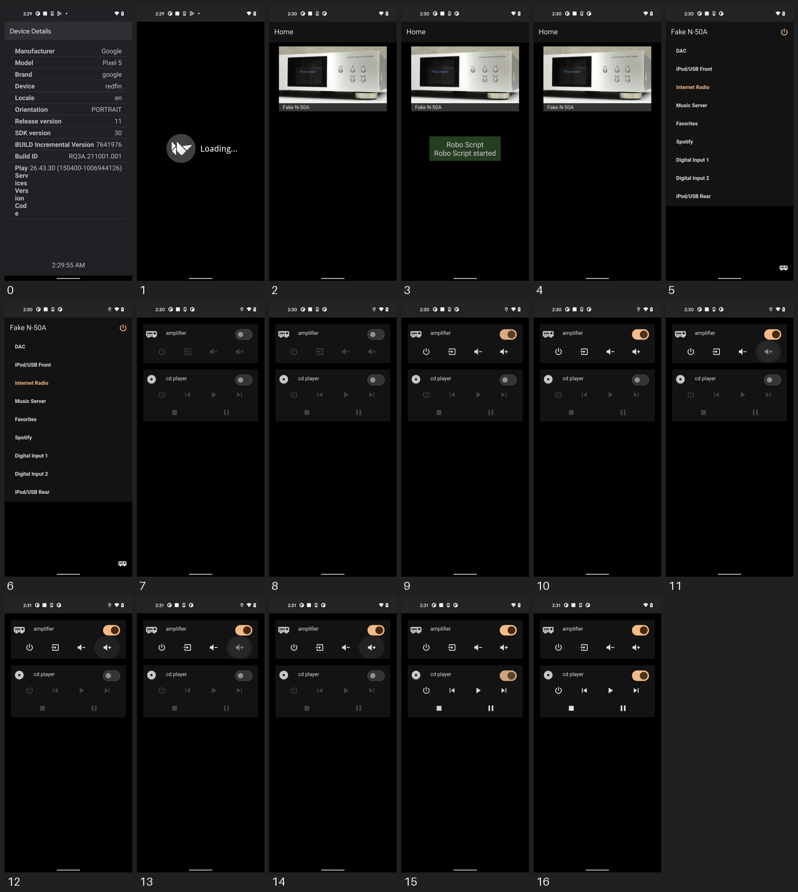
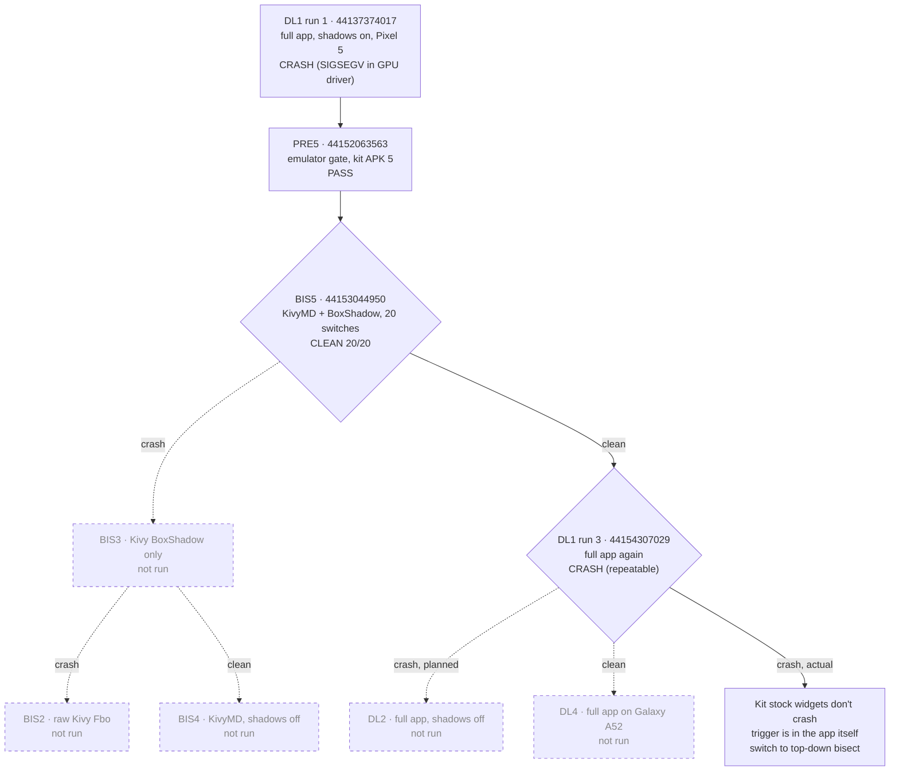
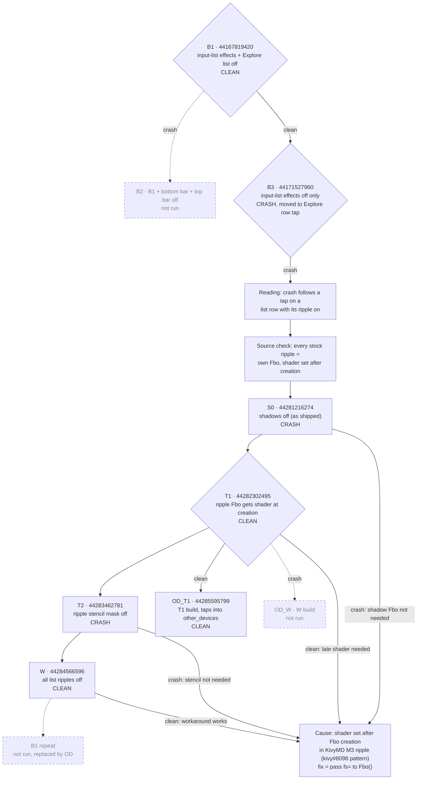

# controlP on Android:​ round 3, crash cause found

- 1\. THE BUG:​ KivyMD's M3 ripple creates its Fbo with Kivy's default shader, then swaps in the ripple shader via fbo\.shader\.fs \(kivymd/uix/behaviors/ripple\_behavior\.py:​701\-702, master a00c10c\)\. On a Pixel 5 \(Adreno, Android 11\) the app crashed in the GPU driver after a list\-row ripple drew\. In every crashing run it was the first ripple the app drew \(the home card's ripple is off by default\)\.
- 2\. THE FIX:​ give the shader to Fbo\(\) when it is created, as kivy/kivy\#8098 did for BoxShadow\. Load the source first \(ripple\.glsl with the &quot;\$HEADER\$ &quot; prefix; the module's RIPPLE\_FS\_STRING is still None at that point\), then:​ self\.fbo = Fbo\(size=\[50\] \* 2, group=&quot;m3\_ripple\_behavior&quot;, fs=fs\), and drop the later self\.set\_shader\(self\.fbo\)\.
- 3\. THE RUNS \(Pixel 5, Android 11, one run each; links in the table below\):​ CRASH with the unmodified ripple \(S0\) and with the stencil off but the same late shader \(T2\)\. CLEAN with the Fbo created with fs= \(T1\), also on the icon buttons and switches of the app's other\-devices screen \(OD\)\. S0 is an older build with shadows off; T1, T2 and OD are one build with shadows on\.
- NOT the stencil \(T2\):​ a ripple with no Stencil instructions but the late shader still crashed, 5 ms after it drew\.
- Workaround also works \(W\):​ ripples off on list items \(W drew no ripple at all\)\. Your per\-class ripple\_effect=False works on MenuItem and InputItem, but NOT on OtherDevicesView:​ it is a screen, so its buttons and switches keep their ripples\.
- Shadows are not needed:​ the crash happened with shadows off \(S0\) and earlier with shadows on \(DL1\)\. Your builds already had shadows off\.
- Limits:​ one run per variant; Pixel 5 = Adreno 620, your Mi 9T = Adreno 618 \(same driver family, not the same GPU\)\.

Pixel 5 \(Adreno 620\) runs:​ the KivyMD M3 ripple sets its shader after creating its Fbo\. Passing the shader at creation stopped the crash; removing the stencil did not\.

[card page](https://accelquasardragon.github.io/kivy-helper-repro/shots/report-round3-2026-11-19/) · [contact sheet](https://accelquasardragon.github.io/kivy-helper-repro/shots/report-round3-2026-11-19/sheet.png)


| Settings / recreate | # | run | question | result | cache | status | screenshots |
|---|---|---|---|---|---|---|---|
| Physical phone:​ Pixel 5 \(redfin\), Android 11, in Google Firebase Test Lab \(our devicelab\.yml flow, new since Nov 17; not an emulator\)\. APK build\-4\-S0\-a1 of matrix run 44177064426 \(shadows off\)\. Taps:​ home card \-&gt; input \-&gt; Music Server \-&gt; album \-&gt; track\. · [how to recreate](#recreate-run-44281216274) | 1 | [S0 shipped config, Pixel 5](https://github.com/AccelQuasarDragon/kivy-helper-repro/actions/runs/44281216274) | controlP cad5d5c \+ offline demo device, shadows off, KivyMD ripple as shipped, real Pixel 5:​ does it crash? | CRASH:​ SIGSEGV fault addr 0x40 in libGLESv2\_adreno\.so &lt;\- vbo &lt;\- instructions &lt;\- compiler &lt;\- fbo, 35 ms after the Music Server row tap opened the album list\. | apk | proven | [phone media](#phone-run-44281216274) |
| Physical phone:​ Pixel 5 \(redfin\), Android 11, in Google Firebase Test Lab \(our devicelab\.yml flow, new since Nov 17; not an emulator\)\. APK build\-5\-T1\-a1 of matrix run 44185768900 \(shadows on, app\_config ripple\_fbo\_fs=create\)\. Same taps as S0\. · [how to recreate](#recreate-run-44282302495) | 2 | [T1 shader at Fbo creation](https://github.com/AccelQuasarDragon/kivy-helper-repro/actions/runs/44282302495) | \(Build with shadows ON\.\) Your app, M3CommonRipple\.init\_fbos patched to pass fs= when the Fbo is created \(never set later\):​ does it crash? | CLEAN:​ home \-&gt; input \-&gt; explore \-&gt; play\. 45 ripples built with fs=\. No tombstone, no fatal signal\. | apk | proven | [phone media](#phone-run-44282302495) |
| Physical phone:​ Pixel 5 \(redfin\), Android 11, in Google Firebase Test Lab \(our devicelab\.yml flow, new since Nov 17; not an emulator\)\. APK build\-5\-T2\-a1 of matrix run 44185768900 \(shadows on, app\_config ripple\_stencil=false\)\. Same taps as S0\. · [how to recreate](#recreate-run-44283462781) | 3 | [T2 ripple without stencil](https://github.com/AccelQuasarDragon/kivy-helper-repro/actions/runs/44283462781) | \(Build with shadows ON\.\) Ripple with no Stencil instructions \(Fbo kept, shader still set after creation\):​ does it crash? | CRASH:​ the stencil\-free ripple drew on the tapped row, then SIGSEGV 0x40 5 ms later, same frames as S0\. | apk | proven | [phone media](#phone-run-44283462781) |
| Physical phone:​ Pixel 5 \(redfin\), Android 11, in Google Firebase Test Lab \(our devicelab\.yml flow, new since Nov 17; not an emulator\)\. APK build\-5\-W\-a1 of matrix run 44185768900 \(shadows on, app\_config list\_ripple=false\)\. Same taps as S0\. · [how to recreate](#recreate-run-44284566596) | 4 | [W list ripples off](https://github.com/AccelQuasarDragon/kivy-helper-repro/actions/runs/44284566596) | \(Build with shadows ON\.\) Ripples off on all list items:​ does it crash? | CLEAN:​ home \-&gt; input \-&gt; explore \-&gt; play\. No tombstone, no fatal signal\. | apk | proven | [phone media](#phone-run-44284566596) |
| Physical phone:​ Pixel 5 \(redfin\), Android 11, in Google Firebase Test Lab \(our devicelab\.yml flow, new since Nov 17; not an emulator\)\. APK build\-5\-T1\-a1 of matrix run 44185768900\. Taps:​ home card \-&gt; input \-&gt; other devices \-&gt; amplifier switch \-&gt; volume\-plus x2 \-&gt; cd player switch\. · [how to recreate](#recreate-run-44285595799) | 5 | [OD other devices, T1 build](https://github.com/AccelQuasarDragon/kivy-helper-repro/actions/runs/44285595799) | \(Build with shadows ON\.\) T1 build, taps into the other\-devices screen:​ amplifier switch, volume\-plus twice, cd player switch:​ does it crash? | CLEAN:​ other\_devices reached, both switches on, volume\-plus ripple seen twice\. No tombstone, no fatal signal\. | apk | proven | [phone media](#phone-run-44285595799) |
| artifact build\-5\-T1\-a1 of run 44185768900 · api\_level 35 · cache off · [how to recreate](#recreate-run-44191222864) | 6 | [T1 emulator gate](https://github.com/AccelQuasarDragon/kivy-helper-repro/actions/runs/44191222864) ([card](https://accelquasardragon.github.io/kivy-helper-repro/shots/44191222864/)) | Before the phone:​ does the T1 APK run the whole tap path on an emulator? | PASS:​ home \-&gt; input \-&gt; explore \-&gt; play, no traceback\. An emulator cannot show the driver crash\. | apk | proven | [05\_tap\_540\_360](https://raw.githubusercontent.com/AccelQuasarDragon/kivy-helper-repro/shots/shots/44191222864/05_tap_540_360.png) |
| artifact build\-5\-T2\-a1 of run 44185768900 · api\_level 35 · cache off · [how to recreate](#recreate-run-44191256830) | 7 | [T2 emulator gate](https://github.com/AccelQuasarDragon/kivy-helper-repro/actions/runs/44191256830) ([card](https://accelquasardragon.github.io/kivy-helper-repro/shots/44191256830/)) | Before the phone:​ does the T2 APK run the whole tap path on an emulator? | PASS, no traceback\. | apk | proven | none |
| artifact build\-5\-W\-a1 of run 44185768900 · api\_level 35 · cache off · [how to recreate](#recreate-run-44191289871) | 8 | [W emulator gate](https://github.com/AccelQuasarDragon/kivy-helper-repro/actions/runs/44191289871) ([card](https://accelquasardragon.github.io/kivy-helper-repro/shots/44191289871/)) | Before the phone:​ does the W APK run the whole tap path on an emulator? | PASS, no traceback\. | apk | proven | none |
| artifact build\-5\-T1\-a1 of run 44185768900 · api\_level 30 · cache off · [how to recreate](#recreate-run-44209486472) | 9 | [OD emulator gate](https://github.com/AccelQuasarDragon/kivy-helper-repro/actions/runs/44209486472) ([card](https://accelquasardragon.github.io/kivy-helper-repro/shots/44209486472/)) | Do the other\-devices taps land \(Pixel 5 screen profile, Android 11\)? | PASS:​ other\_devices reached, amplifier switch on, volume\-plus ripple, cd player switch on\. | apk | proven | [03\_tap\_996\_2139](https://raw.githubusercontent.com/AccelQuasarDragon/kivy-helper-repro/shots/shots/44209486472/03_tap_996_2139.png) [06\_tap\_868\_434](https://raw.githubusercontent.com/AccelQuasarDragon/kivy-helper-repro/shots/shots/44209486472/06_tap_868_434.png) [07\_tap\_876\_672](https://raw.githubusercontent.com/AccelQuasarDragon/kivy-helper-repro/shots/shots/44209486472/07_tap_876_672.png) |

## Phone runs: video frames and screenshots

Firebase Test Lab runs on Google's lab phones. Every image and video here was looked at before publishing.

### Phone run 44281216274

[S0 shipped config, Pixel 5](https://github.com/AccelQuasarDragon/kivy-helper-repro/actions/runs/44281216274)

Phone run \(Firebase Test Lab\):​ device redfin\-30\-en\-portrait · Test Lab outcome Failed \(Application crashed\) · test time 93 s · 7 screenshot\(s\) · video 97 s · 2 crash report file\(s\) · 5 scripted tap\(s\)

Frames sampled from the video:



Video: [video\.mp4](https://accelquasardragon.github.io/kivy-helper-repro/shots/44281216274/video.mp4)

All published screenshots:



[0](https://raw.githubusercontent.com/AccelQuasarDragon/kivy-helper-repro/shots/shots/44281216274/0.png) [1](https://raw.githubusercontent.com/AccelQuasarDragon/kivy-helper-repro/shots/shots/44281216274/1.png) [2](https://raw.githubusercontent.com/AccelQuasarDragon/kivy-helper-repro/shots/shots/44281216274/2.png) [3](https://raw.githubusercontent.com/AccelQuasarDragon/kivy-helper-repro/shots/shots/44281216274/3.png) [4](https://raw.githubusercontent.com/AccelQuasarDragon/kivy-helper-repro/shots/shots/44281216274/4.png) [5](https://raw.githubusercontent.com/AccelQuasarDragon/kivy-helper-repro/shots/shots/44281216274/5.png) [6](https://raw.githubusercontent.com/AccelQuasarDragon/kivy-helper-repro/shots/shots/44281216274/6.png)

### Phone run 44282302495

[T1 shader at Fbo creation](https://github.com/AccelQuasarDragon/kivy-helper-repro/actions/runs/44282302495)

Phone run \(Firebase Test Lab\):​ device redfin\-30\-en\-portrait · Test Lab outcome Passed · test time 85 s · 13 screenshot\(s\) · video 89 s · 0 crash report file\(s\) · 5 scripted tap\(s\)

Frames sampled from the video:



Video: [video\.mp4](https://accelquasardragon.github.io/kivy-helper-repro/shots/44282302495/video.mp4)

All published screenshots:



[0](https://raw.githubusercontent.com/AccelQuasarDragon/kivy-helper-repro/shots/shots/44282302495/0.png) [1](https://raw.githubusercontent.com/AccelQuasarDragon/kivy-helper-repro/shots/shots/44282302495/1.png) [2](https://raw.githubusercontent.com/AccelQuasarDragon/kivy-helper-repro/shots/shots/44282302495/2.png) [3](https://raw.githubusercontent.com/AccelQuasarDragon/kivy-helper-repro/shots/shots/44282302495/3.png) [4](https://raw.githubusercontent.com/AccelQuasarDragon/kivy-helper-repro/shots/shots/44282302495/4.png) [5](https://raw.githubusercontent.com/AccelQuasarDragon/kivy-helper-repro/shots/shots/44282302495/5.png) [6](https://raw.githubusercontent.com/AccelQuasarDragon/kivy-helper-repro/shots/shots/44282302495/6.png) [7](https://raw.githubusercontent.com/AccelQuasarDragon/kivy-helper-repro/shots/shots/44282302495/7.png) [8](https://raw.githubusercontent.com/AccelQuasarDragon/kivy-helper-repro/shots/shots/44282302495/8.png) [9](https://raw.githubusercontent.com/AccelQuasarDragon/kivy-helper-repro/shots/shots/44282302495/9.png) [10](https://raw.githubusercontent.com/AccelQuasarDragon/kivy-helper-repro/shots/shots/44282302495/10.png) [11](https://raw.githubusercontent.com/AccelQuasarDragon/kivy-helper-repro/shots/shots/44282302495/11.png) [12](https://raw.githubusercontent.com/AccelQuasarDragon/kivy-helper-repro/shots/shots/44282302495/12.png)

### Phone run 44283462781

[T2 ripple without stencil](https://github.com/AccelQuasarDragon/kivy-helper-repro/actions/runs/44283462781)

Phone run \(Firebase Test Lab\):​ device redfin\-30\-en\-portrait · Test Lab outcome Failed \(Application crashed\) · test time 88 s · 8 screenshot\(s\) · video 92 s · 2 crash report file\(s\) · 5 scripted tap\(s\)

Frames sampled from the video:



Video: [video\.mp4](https://accelquasardragon.github.io/kivy-helper-repro/shots/44283462781/video.mp4)

All published screenshots:



[0](https://raw.githubusercontent.com/AccelQuasarDragon/kivy-helper-repro/shots/shots/44283462781/0.png) [1](https://raw.githubusercontent.com/AccelQuasarDragon/kivy-helper-repro/shots/shots/44283462781/1.png) [2](https://raw.githubusercontent.com/AccelQuasarDragon/kivy-helper-repro/shots/shots/44283462781/2.png) [3](https://raw.githubusercontent.com/AccelQuasarDragon/kivy-helper-repro/shots/shots/44283462781/3.png) [4](https://raw.githubusercontent.com/AccelQuasarDragon/kivy-helper-repro/shots/shots/44283462781/4.png) [5](https://raw.githubusercontent.com/AccelQuasarDragon/kivy-helper-repro/shots/shots/44283462781/5.png) [6](https://raw.githubusercontent.com/AccelQuasarDragon/kivy-helper-repro/shots/shots/44283462781/6.png) [7](https://raw.githubusercontent.com/AccelQuasarDragon/kivy-helper-repro/shots/shots/44283462781/7.png)

### Phone run 44284566596

[W list ripples off](https://github.com/AccelQuasarDragon/kivy-helper-repro/actions/runs/44284566596)

Phone run \(Firebase Test Lab\):​ device redfin\-30\-en\-portrait · Test Lab outcome Passed · 13 screenshot\(s\) · video 88 s · 0 crash report file\(s\) · 5 scripted tap\(s\)

Frames sampled from the video:


Video: [video\.mp4](https://accelquasardragon.github.io/kivy-helper-repro/shots/44284566596/video.mp4)

All published screenshots:


[0](https://raw.githubusercontent.com/AccelQuasarDragon/kivy-helper-repro/shots/shots/44284566596/0.png) [1](https://raw.githubusercontent.com/AccelQuasarDragon/kivy-helper-repro/shots/shots/44284566596/1.png) [2](https://raw.githubusercontent.com/AccelQuasarDragon/kivy-helper-repro/shots/shots/44284566596/2.png) [3](https://raw.githubusercontent.com/AccelQuasarDragon/kivy-helper-repro/shots/shots/44284566596/3.png) [4](https://raw.githubusercontent.com/AccelQuasarDragon/kivy-helper-repro/shots/shots/44284566596/4.png) [5](https://raw.githubusercontent.com/AccelQuasarDragon/kivy-helper-repro/shots/shots/44284566596/5.png) [6](https://raw.githubusercontent.com/AccelQuasarDragon/kivy-helper-repro/shots/shots/44284566596/6.png) [7](https://raw.githubusercontent.com/AccelQuasarDragon/kivy-helper-repro/shots/shots/44284566596/7.png) [8](https://raw.githubusercontent.com/AccelQuasarDragon/kivy-helper-repro/shots/shots/44284566596/8.png) [9](https://raw.githubusercontent.com/AccelQuasarDragon/kivy-helper-repro/shots/shots/44284566596/9.png) [10](https://raw.githubusercontent.com/AccelQuasarDragon/kivy-helper-repro/shots/shots/44284566596/10.png) [11](https://raw.githubusercontent.com/AccelQuasarDragon/kivy-helper-repro/shots/shots/44284566596/11.png) [12](https://raw.githubusercontent.com/AccelQuasarDragon/kivy-helper-repro/shots/shots/44284566596/12.png)

### Phone run 44285595799

[OD other devices, T1 build](https://github.com/AccelQuasarDragon/kivy-helper-repro/actions/runs/44285595799)

Phone run \(Firebase Test Lab\):​ device redfin\-30\-en\-portrait · Test Lab outcome Passed · test time 94 s · 17 screenshot\(s\) · video 85 s · 0 crash report file\(s\) · 7 scripted tap\(s\)

Frames sampled from the video:



Video: [video\.mp4](https://accelquasardragon.github.io/kivy-helper-repro/shots/44285595799/video.mp4)

All published screenshots:



[0](https://raw.githubusercontent.com/AccelQuasarDragon/kivy-helper-repro/shots/shots/44285595799/0.png) [1](https://raw.githubusercontent.com/AccelQuasarDragon/kivy-helper-repro/shots/shots/44285595799/1.png) [2](https://raw.githubusercontent.com/AccelQuasarDragon/kivy-helper-repro/shots/shots/44285595799/2.png) [3](https://raw.githubusercontent.com/AccelQuasarDragon/kivy-helper-repro/shots/shots/44285595799/3.png) [4](https://raw.githubusercontent.com/AccelQuasarDragon/kivy-helper-repro/shots/shots/44285595799/4.png) [5](https://raw.githubusercontent.com/AccelQuasarDragon/kivy-helper-repro/shots/shots/44285595799/5.png) [6](https://raw.githubusercontent.com/AccelQuasarDragon/kivy-helper-repro/shots/shots/44285595799/6.png) [7](https://raw.githubusercontent.com/AccelQuasarDragon/kivy-helper-repro/shots/shots/44285595799/7.png) [8](https://raw.githubusercontent.com/AccelQuasarDragon/kivy-helper-repro/shots/shots/44285595799/8.png) [9](https://raw.githubusercontent.com/AccelQuasarDragon/kivy-helper-repro/shots/shots/44285595799/9.png) [10](https://raw.githubusercontent.com/AccelQuasarDragon/kivy-helper-repro/shots/shots/44285595799/10.png) [11](https://raw.githubusercontent.com/AccelQuasarDragon/kivy-helper-repro/shots/shots/44285595799/11.png) [12](https://raw.githubusercontent.com/AccelQuasarDragon/kivy-helper-repro/shots/shots/44285595799/12.png) [13](https://raw.githubusercontent.com/AccelQuasarDragon/kivy-helper-repro/shots/shots/44285595799/13.png) [14](https://raw.githubusercontent.com/AccelQuasarDragon/kivy-helper-repro/shots/shots/44285595799/14.png) [15](https://raw.githubusercontent.com/AccelQuasarDragon/kivy-helper-repro/shots/shots/44285595799/15.png) [16](https://raw.githubusercontent.com/AccelQuasarDragon/kivy-helper-repro/shots/shots/44285595799/16.png)

## What crashes

The crash is in KivyMD's M3 ripple, not in your code and not in BoxShadow\. In KivyMD master \(a00c10c\), RectangularRippleBehavior and CircularRippleBehavior are aliases of the M3 classes, so list items, icon buttons and switches all use M3CommonRipple\. M3CommonRipple\.init\_fbos creates an Fbo, and set\_shader then assigns shader\.fs on it\. kivy/kivy\#8098 found that this order breaks on Adreno GPUs, and fixed BoxShadow by passing fs= to Fbo\(\) at creation\. On the Pixel 5 the app died a few ms after a ripple drew, inside libGLESv2\_adreno\.so, under Kivy's fbo / vbo code \(S0\)\.

- [kivy/kivy\#8098](https://github.com/kivy/kivy/pull/8098)
- [kivymd/KivyMD\#1900](https://github.com/kivymd/KivyMD/issues/1900)

## What we changed, one thing per run

All five runs below ran on a physical Pixel 5 \(Android 11\) in Google Firebase Test Lab, through our new devicelab\.yml flow \(scripted taps, screenshots, video, logcat\), not on an emulator\. All runs used your cad5d5c with an offline demo device\. S0 is the shipped config \(shadows off\)\. T1, T2, W and OD come from one later build with shadows ON, and each changes one ripple setting through app\_config\.json\. T1 creates the ripple's Fbo with the shader:​ CLEAN, also on the other\-devices screen \(OD\)\. T2 removes the ripple's stencil but keeps the late shader:​ CRASH\. So the stencil is not the cause\. W turns ripples off on list items:​ CLEAN\. This is the workaround you found\. W drew no ripple at all \(the home card's ripple is off by default\), so it does not show that list rows are special\.

- [bisect toggles \(patch\)](https://github.com/AccelQuasarDragon/kivy-helper-repro/blob/main/patches/controlp/bisect_toggles.diff)
- [how the bisect works](https://github.com/AccelQuasarDragon/kivy-helper-repro/blob/main/docs/bisect.md)

## How we got here:​ flow 1, bottom\-up \(Nov 17\)

Flow 1, bottom\-up \(Nov 17\):​ DL1 full app on the Pixel 5 = CRASH\. A 5\-APK kit of stock widgets \(BIS5:​ KivyMD \+ BoxShadow, 20 screen switches\) = CLEAN\. DL1 again = CRASH, so the trigger is in the app, not in stock widgets alone\. We switched to top\-down\.



- [DL1](https://github.com/AccelQuasarDragon/kivy-helper-repro/actions/runs/44154307029)
- [BIS5](https://github.com/AccelQuasarDragon/kivy-helper-repro/actions/runs/44153044950)

## How we got here:​ flow 2, top\-down \(Nov 17\-18\)

Flow 2, top\-down \(Nov 17\):​ switch groups of your UI off\. B1 \(input\-list effects \+ Explore list off\) = CLEAN\. B3 \(input\-list effects off only\) = CRASH, but it moved to the first tap on an Explore row that still had its ripple\. Then a source check:​ every stock ripple has its own Fbo with the shader set after creation\. Flow 2, one change per run \(Nov 18\):​ S0 shipped = CRASH; T1 shader at Fbo creation = CLEAN; T2 no stencil = CRASH; W list ripples off = CLEAN; OD \(T1 build, other\-devices screen\) = CLEAN\. Planned but not run:​ BIS2\-BIS4, DL2, B2, a B1 repeat \(replaced by OD\)\.



- [B1](https://github.com/AccelQuasarDragon/kivy-helper-repro/actions/runs/44167819420)
- [B3](https://github.com/AccelQuasarDragon/kivy-helper-repro/actions/runs/44171527960)

## Why other\_devices still crashes for you

Your commit sets ripple\_effect = False on MenuItem, InputItem and OtherDevicesView\. MenuItem and InputItem are list items, so it works there\. OtherDevicesView is an MDScreen, which has no ripple, so the line does nothing\. Its 10 MDIconButtons and 2 MDSwitch thumbs keep their M3 ripples, and the entry button in the bottom bar ripples too\. Two ways out:​ switch the ripple off for the whole app \(one patch of M3CommonRipple\), or use the T1 change \(Fbo created with the shader\), which keeps the ripple\.

## Limits

One run per variant, and no run of the unmodified ripple on the shadows\-on build \(the closest are DL1, an earlier shadows\-on build that crashed twice, and T2\); both crashing runs died on the first list\-row tap, but a single clean run is still one run\. The Pixel 5 has an Adreno 620, your Mi 9T an Adreno 618:​ same driver family, not proof for the 618\. You reported the other\-devices crash; we did not run the other\-devices taps on the shipped build, so we did not reproduce that one ourselves\. The phone ran in Firebase Test Lab with scripted taps and a fake device, not your Pioneer\. The screenshots above are from emulator checks; the phone screenshots were read by hand and are in each run's artifact\. Known dead links:​ the 5 phone runs \(Test Lab\) have no card page, so their &quot;card&quot; links 404\. Use each run's Actions link instead\.

## Known gaps

1\. No run of the unmodified ripple on the shadows\-on build \(T1's build\)\. Closest:​ DL1 \(earlier shadows\-on build, crashed twice\) and T2 \(same build, crashed\)\. Close it:​ one run of the shipped config on that build on a physical Pixel 5 in Google Firebase Test Lab \(form inputs only\)\. 2\. Is it list rows, or any first ripple? Every crash was the first ripple drawn, and no late\-shader ripple has ever survived on the Pixel 5\. Close it:​ tap the top\-bar power button \(its own ripple, no list\) before a list row, same Firebase Test Lab run as gap 1\. 3\. GPU coverage:​ only an Adreno 620 was tested; \#1900 has Adreno 506 and 750, your Mi 9T an Adreno 618\. Close it:​ the S0 and T1 APKs on a physical Snapdragon Samsung in Google Firebase Test Lab \(form inputs only\)\. 4\. The fix only ran as an app\-side patch \(T1, code\-identical to the KivyMD diff on desktop\), never as KivyMD itself\. Close it:​ build with KivyMD from a branch carrying the diff, then one physical\-phone run in Google Firebase Test Lab\. 5\. tilt\_behavior\.py in KivyMD sets its shader the same late way and runs on Android; untested, follow\-up\.

## How to recreate

Each run below: its settings, step by step in the Actions tab, and the same as one gh command.

### Recreate run 44281216274

Run 44281216274 \(S0 shipped config, Pixel 5\):​ settings not recorded\.

It has no inputs\.json \(runs before 2026\-11\-16 did not write one\)\.

The report spec gives no recreate inputs for it either\.

### Recreate run 44282302495

Run 44282302495 \(T1 shader at Fbo creation\):​ settings not recorded\.

It has no inputs\.json \(runs before 2026\-11\-16 did not write one\)\.

The report spec gives no recreate inputs for it either\.

### Recreate run 44283462781

Run 44283462781 \(T2 ripple without stencil\):​ settings not recorded\.

It has no inputs\.json \(runs before 2026\-11\-16 did not write one\)\.

The report spec gives no recreate inputs for it either\.

### Recreate run 44284566596

Run 44284566596 \(W list ripples off\):​ settings not recorded\.

It has no inputs\.json \(runs before 2026\-11\-16 did not write one\)\.

The report spec gives no recreate inputs for it either\.

### Recreate run 44285595799

Run 44285595799 \(OD other devices, T1 build\):​ settings not recorded\.

It has no inputs\.json \(runs before 2026\-11\-16 did not write one\)\.

The report spec gives no recreate inputs for it either\.

### Recreate run 44191222864

Run 44191222864 \(T1 emulator gate\)\.

These settings were recorded by the run itself \(shots/&lt;id&gt;/inputs\.json\)\.

A new run builds again:​ it reproduces the inputs, not the exact bytes of that run\.

1. Open the inspect apk workflow in the Actions tab: [inspect\.yml](https://github.com/AccelQuasarDragon/kivy-helper-repro/actions/workflows/inspect.yml).
2. Click &quot;Run workflow&quot; \(top right of the run list\); keep the branch &quot;main&quot;\.
3. Set the field &quot;label&quot; to:​ `controlP bisect gate T1 ripple_fbo_fs=create from matrix run 44185768900`
4. Set the field &quot;artifact\_run&quot; to:​ `44185768900`
5. Set the field &quot;artifact\_name&quot; to:​ `build-5-T1-a1`
6. Set the field &quot;taps&quot; to:​ `540,2000,5;540,600,8;540,800,8;540,360,8;540,360,10`
7. Set the field &quot;launch\_wait&quot; to:​ `45`
8. Leave every other field at its default\.
9. Click the green &quot;Run workflow&quot; button\.

Or with the GitHub CLI (`gh`):

```sh
gh workflow run inspect.yml --repo AccelQuasarDragon/kivy-helper-repro --ref main --json <<'JSON'
{
 "label": "controlP bisect gate T1 ripple_fbo_fs=create from matrix run 44185768900",
 "artifact_run": "44185768900",
 "artifact_name": "build-5-T1-a1",
 "taps": "540,2000,5;540,600,8;540,800,8;540,360,8;540,360,10",
 "launch_wait": "45"
}
JSON
```

### Recreate run 44191256830

Run 44191256830 \(T2 emulator gate\)\.

These settings were recorded by the run itself \(shots/&lt;id&gt;/inputs\.json\)\.

A new run builds again:​ it reproduces the inputs, not the exact bytes of that run\.

1. Open the inspect apk workflow in the Actions tab: [inspect\.yml](https://github.com/AccelQuasarDragon/kivy-helper-repro/actions/workflows/inspect.yml).
2. Click &quot;Run workflow&quot; \(top right of the run list\); keep the branch &quot;main&quot;\.
3. Set the field &quot;label&quot; to:​ `controlP bisect gate T2 ripple_stencil=false from matrix run 44185768900`
4. Set the field &quot;artifact\_run&quot; to:​ `44185768900`
5. Set the field &quot;artifact\_name&quot; to:​ `build-5-T2-a1`
6. Set the field &quot;taps&quot; to:​ `540,2000,5;540,600,8;540,800,8;540,360,8;540,360,10`
7. Set the field &quot;launch\_wait&quot; to:​ `45`
8. Leave every other field at its default\.
9. Click the green &quot;Run workflow&quot; button\.

Or with the GitHub CLI (`gh`):

```sh
gh workflow run inspect.yml --repo AccelQuasarDragon/kivy-helper-repro --ref main --json <<'JSON'
{
 "label": "controlP bisect gate T2 ripple_stencil=false from matrix run 44185768900",
 "artifact_run": "44185768900",
 "artifact_name": "build-5-T2-a1",
 "taps": "540,2000,5;540,600,8;540,800,8;540,360,8;540,360,10",
 "launch_wait": "45"
}
JSON
```

### Recreate run 44191289871

Run 44191289871 \(W emulator gate\)\.

These settings were recorded by the run itself \(shots/&lt;id&gt;/inputs\.json\)\.

A new run builds again:​ it reproduces the inputs, not the exact bytes of that run\.

1. Open the inspect apk workflow in the Actions tab: [inspect\.yml](https://github.com/AccelQuasarDragon/kivy-helper-repro/actions/workflows/inspect.yml).
2. Click &quot;Run workflow&quot; \(top right of the run list\); keep the branch &quot;main&quot;\.
3. Set the field &quot;label&quot; to:​ `controlP bisect gate W list_ripple=false from matrix run 44185768900`
4. Set the field &quot;artifact\_run&quot; to:​ `44185768900`
5. Set the field &quot;artifact\_name&quot; to:​ `build-5-W-a1`
6. Set the field &quot;taps&quot; to:​ `540,2000,5;540,600,8;540,800,8;540,360,8;540,360,10`
7. Set the field &quot;launch\_wait&quot; to:​ `45`
8. Leave every other field at its default\.
9. Click the green &quot;Run workflow&quot; button\.

Or with the GitHub CLI (`gh`):

```sh
gh workflow run inspect.yml --repo AccelQuasarDragon/kivy-helper-repro --ref main --json <<'JSON'
{
 "label": "controlP bisect gate W list_ripple=false from matrix run 44185768900",
 "artifact_run": "44185768900",
 "artifact_name": "build-5-W-a1",
 "taps": "540,2000,5;540,600,8;540,800,8;540,360,8;540,360,10",
 "launch_wait": "45"
}
JSON
```

### Recreate run 44209486472

Run 44209486472 \(OD emulator gate\)\.

These settings were recorded by the run itself \(shots/&lt;id&gt;/inputs\.json\)\.

A new run builds again:​ it reproduces the inputs, not the exact bytes of that run\.

1. Open the inspect apk workflow in the Actions tab: [inspect\.yml](https://github.com/AccelQuasarDragon/kivy-helper-repro/actions/workflows/inspect.yml).
2. Click &quot;Run workflow&quot; \(top right of the run list\); keep the branch &quot;main&quot;\.
3. Set the field &quot;label&quot; to:​ `controlP OD gate 3 full OD taps (T1 build, pixel_5 API 30) from matrix run 44185768900`
4. Set the field &quot;artifact\_run&quot; to:​ `44185768900`
5. Set the field &quot;artifact\_name&quot; to:​ `build-5-T1-a1`
6. Set the field &quot;api\_level&quot; to:​ `30`
7. Set the field &quot;profile&quot; to:​ `pixel_5`
8. Set the field &quot;taps&quot; to:​ `540,2000,5;540,600,8;996,2139,8;876,288,5;868,434,5;868,434,5;876,672,8`
9. Set the field &quot;launch\_wait&quot; to:​ `45`
10. Leave every other field at its default\.
11. Click the green &quot;Run workflow&quot; button\.

Or with the GitHub CLI (`gh`):

```sh
gh workflow run inspect.yml --repo AccelQuasarDragon/kivy-helper-repro --ref main --json <<'JSON'
{
 "label": "controlP OD gate 3 full OD taps (T1 build, pixel_5 API 30) from matrix run 44185768900",
 "artifact_run": "44185768900",
 "artifact_name": "build-5-T1-a1",
 "api_level": "30",
 "profile": "pixel_5",
 "taps": "540,2000,5;540,600,8;996,2139,8;876,288,5;868,434,5;868,434,5;876,672,8",
 "launch_wait": "45"
}
JSON
```
