# controlP on Android:​ round 3b, fix tested inside KivyMD

- 1\. THE BUG:​ KivyMD's M3 ripple creates its Fbo with Kivy's default shader, then assigns the ripple shader via fbo\.shader\.fs \(kivymd/uix/behaviors/ripple\_behavior\.py:​701\-702, master a00c10c\)\. On Adreno GPUs \(Pixel 5:​ Adreno 620, Android 11; Galaxy A52 5G:​ Adreno 619, Android 14\) the app crashes in the GPU driver right after the first ripple draws\.
- 2\. THE FIX:​ give the shader to Fbo\(\) when it is created, as kivy/kivy\#8098 did for BoxShadow\. Load the source first \(ripple\.glsl with the &quot;\$HEADER\$\\n&quot; prefix; RIPPLE\_FS\_STRING is still None at that point\), then:​ self\.fbo = Fbo\(size=\[50\] \* 2, group=&quot;m3\_ripple\_behavior&quot;, fs=fs\), and drop the later self\.set\_shader\(self\.fbo\)\. Tested as KivyMD fork commit e0f0ca0\.
- 3\. THE RUNS \(physical phones in Firebase Test Lab, links below\):​ shipped KivyMD or PR \#1907 = CRASH in every run \(S0, B0S, R1 on the Pixel 5; D1 on the Galaxy A52; mC0 = a \~200\-line KivyMD\-only app\)\. KivyMD with the fix = CLEAN 6 of 6 \(R2, R3, R4 on the Pixel 5; D2, D3 on the Galaxy A52; mPRFS in the minimal app\)\.
- NOT the stencil \(T2\):​ a ripple with no Stencil instructions but the late shader still crashed, 5 ms after it drew\.
- NOT fixed by KivyMD PR \#1907 \(R1\):​ it fixes the 0\-px Fbo error \(\#1894\) but still sets the shader late, and crashed 353 ms after the first ripple\.
- Workaround \(W, list ripples off\):​ clean but no ripple at all; on OtherDevicesView your ripple\_effect=False does nothing \(see below\)\. S0 = your cad5d5c, before that commit\.
- Shadows are not needed:​ the crash happened with shadows off \(S0\) and on \(B0S, DL1\)\. Your builds already had shadows off\.

KivyMD's M3 ripple sets its shader after creating its Fbo; that crashes Adreno 620/619 phones\. Shader at creation \(fork e0f0ca0\):​ clean 6/6; shipped KivyMD and \#1907:​ crashed\.

[card page](https://accelquasardragon.github.io/kivy-helper-repro/shots/report-round3b-2026-11-20/) · [contact sheet](https://accelquasardragon.github.io/kivy-helper-repro/shots/report-round3b-2026-11-20/sheet.png)


| Settings / recreate | # | run | question | result | cache | status | screenshots |
|---|---|---|---|---|---|---|---|
| Cold build, matrix 44177064426:​ shipped config, shadows off\. · [how to recreate](#recreate-run-44281216274) | 1 | [S0 shipped config, Pixel 5](https://github.com/AccelQuasarDragon/kivy-helper-repro/actions/runs/44281216274) | controlP cad5d5c \+ offline demo device, shadows off, KivyMD ripple as shipped, real Pixel 5:​ does it crash? | 🔴 **CRASH** SIGSEGV fault addr 0x40 in libGLESv2\_adreno\.so &lt;\- vbo &lt;\- instructions &lt;\- compiler &lt;\- fbo, 35 ms after the Music Server row tap opened the album list\. | apk | proven | [0](https://raw.githubusercontent.com/AccelQuasarDragon/kivy-helper-repro/shots/shots/44281216274/0.png) [1](https://raw.githubusercontent.com/AccelQuasarDragon/kivy-helper-repro/shots/shots/44281216274/1.png) [2](https://raw.githubusercontent.com/AccelQuasarDragon/kivy-helper-repro/shots/shots/44281216274/2.png) · [phone media](#run-44281216274) |
| Cold build, matrix 44185768900:​ shadows on, app\_config ripple\_fbo\_fs=create\. · [how to recreate](#recreate-run-44282302495) | 2 | [T1 shader at Fbo creation](https://github.com/AccelQuasarDragon/kivy-helper-repro/actions/runs/44282302495) | Your app, M3CommonRipple\.init\_fbos patched to pass fs= when the Fbo is created \(never set later\):​ does it crash? | 🟢 **CLEAN** home \-&gt; input \-&gt; explore \-&gt; play\. 45 ripples built with fs=\. No tombstone, no fatal signal\. | apk | proven | [0](https://raw.githubusercontent.com/AccelQuasarDragon/kivy-helper-repro/shots/shots/44282302495/0.png) [1](https://raw.githubusercontent.com/AccelQuasarDragon/kivy-helper-repro/shots/shots/44282302495/1.png) [2](https://raw.githubusercontent.com/AccelQuasarDragon/kivy-helper-repro/shots/shots/44282302495/2.png) · [phone media](#run-44282302495) |
| Same build:​ app\_config ripple\_stencil=false\. · [how to recreate](#recreate-run-44283462781) | 3 | [T2 ripple without stencil](https://github.com/AccelQuasarDragon/kivy-helper-repro/actions/runs/44283462781) | Ripple with no Stencil instructions \(Fbo kept, shader still set after creation\):​ does it crash? | 🔴 **CRASH** the stencil\-free ripple drew on the tapped row, then SIGSEGV 0x40 5 ms later, same frames as S0\. | apk | proven | [0](https://raw.githubusercontent.com/AccelQuasarDragon/kivy-helper-repro/shots/shots/44283462781/0.png) [1](https://raw.githubusercontent.com/AccelQuasarDragon/kivy-helper-repro/shots/shots/44283462781/1.png) [2](https://raw.githubusercontent.com/AccelQuasarDragon/kivy-helper-repro/shots/shots/44283462781/2.png) · [phone media](#run-44283462781) |
| Same build:​ app\_config list\_ripple=false\. · [how to recreate](#recreate-run-44284566596) | 4 | [W list ripples off](https://github.com/AccelQuasarDragon/kivy-helper-repro/actions/runs/44284566596) | Ripples off on all list items:​ does it crash? | 🟢 **CLEAN** home \-&gt; input \-&gt; explore \-&gt; play\. No tombstone, no fatal signal\. | apk | proven | [0](https://raw.githubusercontent.com/AccelQuasarDragon/kivy-helper-repro/shots/shots/44284566596/0.png) [1](https://raw.githubusercontent.com/AccelQuasarDragon/kivy-helper-repro/shots/shots/44284566596/1.png) [2](https://raw.githubusercontent.com/AccelQuasarDragon/kivy-helper-repro/shots/shots/44284566596/2.png) · [phone media](#run-44284566596) |
| T1 APK; taps into the other\-devices screen\. · [how to recreate](#recreate-run-44285595799) | 5 | [OD other devices, T1 build](https://github.com/AccelQuasarDragon/kivy-helper-repro/actions/runs/44285595799) | T1 build, taps into the other\-devices screen:​ amplifier switch, volume\-plus twice, cd player switch:​ does it crash? | 🟢 **CLEAN** other\_devices reached, both switches on, volume\-plus ripple seen twice\. No tombstone, no fatal signal\. | apk | proven | [0](https://raw.githubusercontent.com/AccelQuasarDragon/kivy-helper-repro/shots/shots/44285595799/0.png) [1](https://raw.githubusercontent.com/AccelQuasarDragon/kivy-helper-repro/shots/shots/44285595799/1.png) [2](https://raw.githubusercontent.com/AccelQuasarDragon/kivy-helper-repro/shots/shots/44285595799/2.png) · [phone media](#run-44285595799) |
| artifact build\-6\-B0S\-a1 of run 44324237484 · device redfin API 30 · [how to recreate](#recreate-run-44501582277) | 6 | [B0S shipped ripple, shadows on](https://github.com/AccelQuasarDragon/kivy-helper-repro/actions/runs/44501582277) | Fresh shadows\-on build, ripple as shipped, power button first:​ crash? | 🔴 **CRASH** SIGSEGV 0x40 in libGLESv2\_adreno\.so 0\.36 s after the top\-bar power tap \(its own ripple, no list\), same backtrace as S0\. | apk | proven | [0](https://raw.githubusercontent.com/AccelQuasarDragon/kivy-helper-repro/shots/shots/44501582277/0.png) [1](https://raw.githubusercontent.com/AccelQuasarDragon/kivy-helper-repro/shots/shots/44501582277/1.png) [2](https://raw.githubusercontent.com/AccelQuasarDragon/kivy-helper-repro/shots/shots/44501582277/2.png) · [phone media](#run-44501582277) |
| artifact build\-7\-P1907\-a1 of run 44580816339 · device redfin API 30 · [how to recreate](#recreate-run-44589140589) | 7 | [R1 KivyMD PR \#1907](https://github.com/AccelQuasarDragon/kivy-helper-repro/actions/runs/44589140589) | KivyMD PR \#1907 \(dp\(1\) Fbo \+ clamp, shader still set late\):​ crash? | 🔴 **CRASH** SIGSEGV 0x40, adreno x4 &lt;\- vbo &lt;\- instructions &lt;\- compiler, 353 ms after the first power tap\. | apk | proven | [0](https://raw.githubusercontent.com/AccelQuasarDragon/kivy-helper-repro/shots/shots/44589140589/0.png) [1](https://raw.githubusercontent.com/AccelQuasarDragon/kivy-helper-repro/shots/shots/44589140589/1.png) [2](https://raw.githubusercontent.com/AccelQuasarDragon/kivy-helper-repro/shots/shots/44589140589/2.png) · [phone media](#run-44589140589) |
| artifact build\-7\-PRFS\-a1 of run 44580816339 · device redfin API 30 · [how to recreate](#recreate-run-44590309751) | 8 | [R2 KivyMD fs= fix, power x2](https://github.com/AccelQuasarDragon/kivy-helper-repro/actions/runs/44590309751) | KivyMD fork e0f0ca0 \(Fbo created with fs=\), same taps as R1:​ crash? | 🟢 **CLEAN** power x2 \(ripple circle drawn behind the icon\), then Music Server row \-&gt; album list \-&gt; back, twice\. | apk | proven | [0](https://raw.githubusercontent.com/AccelQuasarDragon/kivy-helper-repro/shots/shots/44590309751/0.png) [1](https://raw.githubusercontent.com/AccelQuasarDragon/kivy-helper-repro/shots/shots/44590309751/1.png) [2](https://raw.githubusercontent.com/AccelQuasarDragon/kivy-helper-repro/shots/shots/44590309751/2.png) · [phone media](#run-44590309751) |
| artifact build\-7\-PRFS\-a1 of run 44580816339 · device redfin API 30 · [how to recreate](#recreate-run-44591562998) | 9 | [R3 fs= fix, list row x3](https://github.com/AccelQuasarDragon/kivy-helper-repro/actions/runs/44591562998) | Fork e0f0ca0, list\-row ripple three times with leave/return:​ crash? | 🟢 **CLEAN** three list\-row ripples, no tombstone, no fatal signal\. | apk | proven | [0](https://raw.githubusercontent.com/AccelQuasarDragon/kivy-helper-repro/shots/shots/44591562998/0.png) [1](https://raw.githubusercontent.com/AccelQuasarDragon/kivy-helper-repro/shots/shots/44591562998/1.png) [2](https://raw.githubusercontent.com/AccelQuasarDragon/kivy-helper-repro/shots/shots/44591562998/2.png) · [phone media](#run-44591562998) |
| artifact build\-7\-PRFS\-a1 of run 44580816339 · device redfin API 30 · [how to recreate](#recreate-run-44592679382) | 10 | [R4 fs= fix, other devices](https://github.com/AccelQuasarDragon/kivy-helper-repro/actions/runs/44592679382) | Fork e0f0ca0, the other\-devices taps \(switches, volume\-plus x2\):​ crash? | 🟢 **CLEAN** other\_devices reached, switch and icon\-button ripples, no fatal signal\. | apk | proven | [0](https://raw.githubusercontent.com/AccelQuasarDragon/kivy-helper-repro/shots/shots/44592679382/0.png) [1](https://raw.githubusercontent.com/AccelQuasarDragon/kivy-helper-repro/shots/shots/44592679382/1.png) [2](https://raw.githubusercontent.com/AccelQuasarDragon/kivy-helper-repro/shots/shots/44592679382/2.png) · [phone media](#run-44592679382) |
| artifact build\-7\-C0\-a1 of run 44580816339 · device a52xq API 34 · [how to recreate](#recreate-run-44716239758) | 11 | [D1 shipped ripple, Galaxy A52](https://github.com/AccelQuasarDragon/kivy-helper-repro/actions/runs/44716239758) | Shipped KivyMD \(a00c10c\) on a Galaxy A52 5G \(Adreno 619, Android 14\):​ crash? | 🔴 **CRASH** SIGSEGV 0x40 about 120 ms after the Music Server row tap, same backtrace as on the Pixel 5\. | apk | proven | [0](https://raw.githubusercontent.com/AccelQuasarDragon/kivy-helper-repro/shots/shots/44716239758/0.png) [1](https://raw.githubusercontent.com/AccelQuasarDragon/kivy-helper-repro/shots/shots/44716239758/1.png) · [phone media](#run-44716239758) |
| artifact build\-7\-PRFS\-a1 of run 44580816339 · device a52xq API 34 · [how to recreate](#recreate-run-44717304020) | 12 | [D2 fs= fix, Galaxy A52](https://github.com/AccelQuasarDragon/kivy-helper-repro/actions/runs/44717304020) | Fork e0f0ca0 APK, same taps on the Galaxy A52:​ crash? | 🟢 **CLEAN** reached the track list, no fatal signal\. | apk | proven | [0](https://raw.githubusercontent.com/AccelQuasarDragon/kivy-helper-repro/shots/shots/44717304020/0.png) [1](https://raw.githubusercontent.com/AccelQuasarDragon/kivy-helper-repro/shots/shots/44717304020/1.png) · [phone media](#run-44717304020) |
| artifact build\-7\-PRFS\-a1 of run 44580816339 · device a52xq API 34 · [how to recreate](#recreate-run-44718163639) | 13 | [D3 fs= fix, Galaxy A52, repeat](https://github.com/AccelQuasarDragon/kivy-helper-repro/actions/runs/44718163639) | D2 again:​ still clean? | 🟢 **CLEAN** reached the track list, no fatal signal\. | apk | proven | [0](https://raw.githubusercontent.com/AccelQuasarDragon/kivy-helper-repro/shots/shots/44718163639/0.png) [1](https://raw.githubusercontent.com/AccelQuasarDragon/kivy-helper-repro/shots/shots/44718163639/1.png) · [phone media](#run-44718163639) |
| artifact build\-8\-mC0\-a1 of run 44584005765 · device redfin API 30 · [how to recreate](#recreate-run-44719013412) | 14 | [mC0 minimal app, shipped ripple](https://github.com/AccelQuasarDragon/kivy-helper-repro/actions/runs/44719013412) | A \~200\-line KivyMD\-only app \(none of your code\), shipped KivyMD a00c10c:​ crash? | CRASH during its first ripple \(top\-bar button tap\), same backtrace\. | apk | proven | [0](https://raw.githubusercontent.com/AccelQuasarDragon/kivy-helper-repro/shots/shots/44719013412/0.png) [1](https://raw.githubusercontent.com/AccelQuasarDragon/kivy-helper-repro/shots/shots/44719013412/1.png) · [phone media](#run-44719013412) |
| artifact build\-8\-mPRFS\-a1 of run 44584005765 · device redfin API 30 · [how to recreate](#recreate-run-44719993437) | 15 | [mPRFS minimal app, fs= fix](https://github.com/AccelQuasarDragon/kivy-helper-repro/actions/runs/44719993437) | Same minimal app with fork e0f0ca0:​ crash? | 🟢 **CLEAN** home, second, third, home, second; top\-bar ripple x2, no fatal signal\. | apk | proven | [0](https://raw.githubusercontent.com/AccelQuasarDragon/kivy-helper-repro/shots/shots/44719993437/0.png) [1](https://raw.githubusercontent.com/AccelQuasarDragon/kivy-helper-repro/shots/shots/44719993437/1.png) · [phone media](#run-44719993437) |

## Runs

Firebase Test Lab runs on Google's lab phones\. Every image and video here was looked at before publishing\.

<a id="run-44281216274"></a>

### S0 shipped config, Pixel 5 · 🔴 CRASH

| Field | Value |
|---|---|
| **Result** | 🔴 **CRASH** SIGSEGV fault addr 0x40 in libGLESv2\_adreno\.so &lt;\- vbo &lt;\- instructions &lt;\- compiler &lt;\- fbo, 35 ms after the Music Server row tap opened the album list\. |
| **What we learned** | The shipped ripple crashes on this phone with no change, so the bug reproduces\. |
| **Question** | controlP cad5d5c \+ offline demo device, shadows off, KivyMD ripple as shipped, real Pixel 5:​ does it crash? |
| **Where it ran** | Physical phone in Google Firebase Test Lab \(devicelab\.yml\):​ device redfin\-30\-en\-portrait, not an emulator |
| **Settings** | Cold build, matrix 44177064426:​ shipped config, shadows off\. |
| **Test Lab** | device redfin\-30\-en\-portrait · Test Lab outcome Failed \(Application crashed\) · test time 93 s · 7 screenshot\(s\) · video 97 s · 2 crash report file\(s\) · 5 scripted tap\(s\) |
| **Evidence** | APK · proven |
| **Links** | [Actions run](https://github.com/AccelQuasarDragon/kivy-helper-repro/actions/runs/44281216274) · [how to recreate](#recreate-run-44281216274) |

Video: [video\.mp4](https://accelquasardragon.github.io/kivy-helper-repro/shots/44281216274/video.mp4)

Frames sampled from the video:

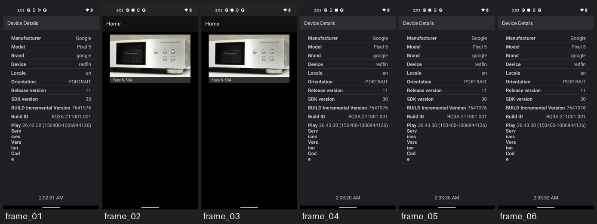

All published screenshots:


[0](https://raw.githubusercontent.com/AccelQuasarDragon/kivy-helper-repro/shots/shots/44281216274/0.png) [1](https://raw.githubusercontent.com/AccelQuasarDragon/kivy-helper-repro/shots/shots/44281216274/1.png) [2](https://raw.githubusercontent.com/AccelQuasarDragon/kivy-helper-repro/shots/shots/44281216274/2.png) [3](https://raw.githubusercontent.com/AccelQuasarDragon/kivy-helper-repro/shots/shots/44281216274/3.png) [4](https://raw.githubusercontent.com/AccelQuasarDragon/kivy-helper-repro/shots/shots/44281216274/4.png) [5](https://raw.githubusercontent.com/AccelQuasarDragon/kivy-helper-repro/shots/shots/44281216274/5.png) [6](https://raw.githubusercontent.com/AccelQuasarDragon/kivy-helper-repro/shots/shots/44281216274/6.png)

<a id="run-44282302495"></a>

### T1 shader at Fbo creation · 🟢 CLEAN

| Field | Value |
|---|---|
| **Result** | 🟢 **CLEAN** home \-&gt; input \-&gt; explore \-&gt; play\. 45 ripples built with fs=\. No tombstone, no fatal signal\. |
| **What we learned** | Giving the shader when the Fbo is created stops the crash\. This is the fix\. |
| **Question** | Your app, M3CommonRipple\.init\_fbos patched to pass fs= when the Fbo is created \(never set later\):​ does it crash? |
| **Where it ran** | Physical phone in Google Firebase Test Lab \(devicelab\.yml\):​ device redfin\-30\-en\-portrait, not an emulator |
| **Settings** | Cold build, matrix 44185768900:​ shadows on, app\_config ripple\_fbo\_fs=create\. |
| **Test Lab** | device redfin\-30\-en\-portrait · Test Lab outcome Passed · test time 85 s · 13 screenshot\(s\) · video 89 s · 0 crash report file\(s\) · 5 scripted tap\(s\) |
| **Evidence** | APK · proven |
| **Links** | [Actions run](https://github.com/AccelQuasarDragon/kivy-helper-repro/actions/runs/44282302495) · [how to recreate](#recreate-run-44282302495) |

Video: [video\.mp4](https://accelquasardragon.github.io/kivy-helper-repro/shots/44282302495/video.mp4)

Frames sampled from the video:

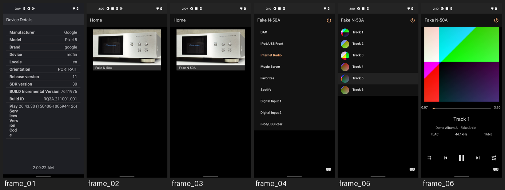

All published screenshots:

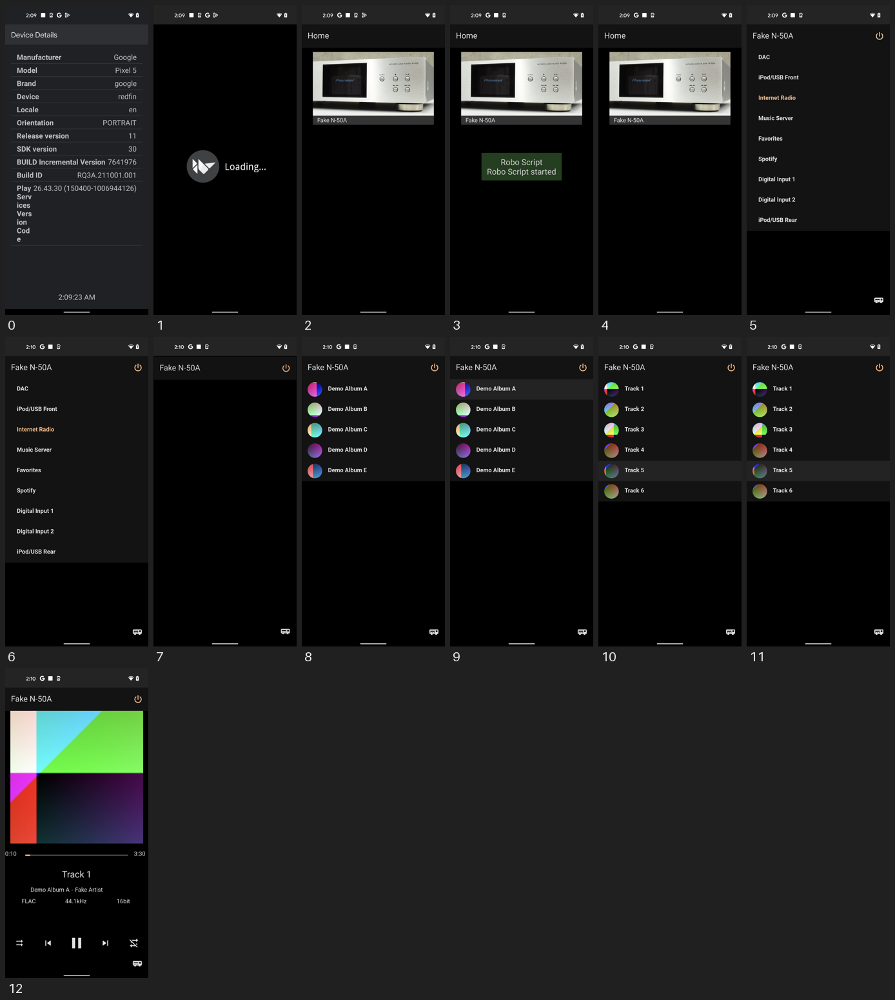

[0](https://raw.githubusercontent.com/AccelQuasarDragon/kivy-helper-repro/shots/shots/44282302495/0.png) [1](https://raw.githubusercontent.com/AccelQuasarDragon/kivy-helper-repro/shots/shots/44282302495/1.png) [2](https://raw.githubusercontent.com/AccelQuasarDragon/kivy-helper-repro/shots/shots/44282302495/2.png) [3](https://raw.githubusercontent.com/AccelQuasarDragon/kivy-helper-repro/shots/shots/44282302495/3.png) [4](https://raw.githubusercontent.com/AccelQuasarDragon/kivy-helper-repro/shots/shots/44282302495/4.png) [5](https://raw.githubusercontent.com/AccelQuasarDragon/kivy-helper-repro/shots/shots/44282302495/5.png) [6](https://raw.githubusercontent.com/AccelQuasarDragon/kivy-helper-repro/shots/shots/44282302495/6.png) [7](https://raw.githubusercontent.com/AccelQuasarDragon/kivy-helper-repro/shots/shots/44282302495/7.png) [8](https://raw.githubusercontent.com/AccelQuasarDragon/kivy-helper-repro/shots/shots/44282302495/8.png) [9](https://raw.githubusercontent.com/AccelQuasarDragon/kivy-helper-repro/shots/shots/44282302495/9.png) [10](https://raw.githubusercontent.com/AccelQuasarDragon/kivy-helper-repro/shots/shots/44282302495/10.png) [11](https://raw.githubusercontent.com/AccelQuasarDragon/kivy-helper-repro/shots/shots/44282302495/11.png) [12](https://raw.githubusercontent.com/AccelQuasarDragon/kivy-helper-repro/shots/shots/44282302495/12.png)

<a id="run-44283462781"></a>

### T2 ripple without stencil · 🔴 CRASH

| Field | Value |
|---|---|
| **Result** | 🔴 **CRASH** the stencil\-free ripple drew on the tapped row, then SIGSEGV 0x40 5 ms later, same frames as S0\. |
| **What we learned** | Removing the stencil doesn't help, so the stencil is not the cause\. |
| **Question** | Ripple with no Stencil instructions \(Fbo kept, shader still set after creation\):​ does it crash? |
| **Where it ran** | Physical phone in Google Firebase Test Lab \(devicelab\.yml\):​ device redfin\-30\-en\-portrait, not an emulator |
| **Settings** | Same build:​ app\_config ripple\_stencil=false\. |
| **Test Lab** | device redfin\-30\-en\-portrait · Test Lab outcome Failed \(Application crashed\) · test time 88 s · 8 screenshot\(s\) · video 92 s · 2 crash report file\(s\) · 5 scripted tap\(s\) |
| **Evidence** | APK · proven |
| **Links** | [Actions run](https://github.com/AccelQuasarDragon/kivy-helper-repro/actions/runs/44283462781) · [how to recreate](#recreate-run-44283462781) |

Video: [video\.mp4](https://accelquasardragon.github.io/kivy-helper-repro/shots/44283462781/video.mp4)

Frames sampled from the video:

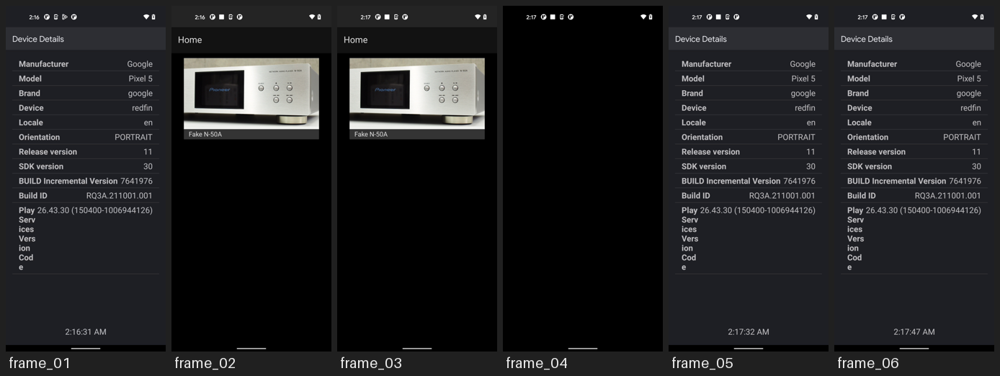

All published screenshots:

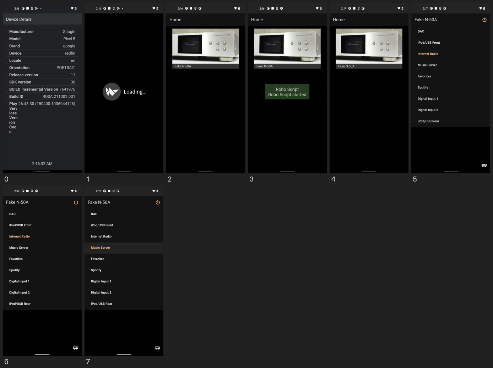

[0](https://raw.githubusercontent.com/AccelQuasarDragon/kivy-helper-repro/shots/shots/44283462781/0.png) [1](https://raw.githubusercontent.com/AccelQuasarDragon/kivy-helper-repro/shots/shots/44283462781/1.png) [2](https://raw.githubusercontent.com/AccelQuasarDragon/kivy-helper-repro/shots/shots/44283462781/2.png) [3](https://raw.githubusercontent.com/AccelQuasarDragon/kivy-helper-repro/shots/shots/44283462781/3.png) [4](https://raw.githubusercontent.com/AccelQuasarDragon/kivy-helper-repro/shots/shots/44283462781/4.png) [5](https://raw.githubusercontent.com/AccelQuasarDragon/kivy-helper-repro/shots/shots/44283462781/5.png) [6](https://raw.githubusercontent.com/AccelQuasarDragon/kivy-helper-repro/shots/shots/44283462781/6.png) [7](https://raw.githubusercontent.com/AccelQuasarDragon/kivy-helper-repro/shots/shots/44283462781/7.png)

<a id="run-44284566596"></a>

### W list ripples off · 🟢 CLEAN

| Field | Value |
|---|---|
| **Result** | 🟢 **CLEAN** home \-&gt; input \-&gt; explore \-&gt; play\. No tombstone, no fatal signal\. |
| **What we learned** | With list ripples off there's no crash, so your workaround works\. But it drew no ripple at all\. |
| **Question** | Ripples off on all list items:​ does it crash? |
| **Where it ran** | Physical phone in Google Firebase Test Lab \(devicelab\.yml\):​ device redfin\-30\-en\-portrait, not an emulator |
| **Settings** | Same build:​ app\_config list\_ripple=false\. |
| **Test Lab** | device redfin\-30\-en\-portrait · Test Lab outcome Passed · 13 screenshot\(s\) · video 88 s · 0 crash report file\(s\) · 5 scripted tap\(s\) |
| **Evidence** | APK · proven |
| **Links** | [Actions run](https://github.com/AccelQuasarDragon/kivy-helper-repro/actions/runs/44284566596) · [how to recreate](#recreate-run-44284566596) |

Video: [video\.mp4](https://accelquasardragon.github.io/kivy-helper-repro/shots/44284566596/video.mp4)

Frames sampled from the video:


All published screenshots:


[0](https://raw.githubusercontent.com/AccelQuasarDragon/kivy-helper-repro/shots/shots/44284566596/0.png) [1](https://raw.githubusercontent.com/AccelQuasarDragon/kivy-helper-repro/shots/shots/44284566596/1.png) [2](https://raw.githubusercontent.com/AccelQuasarDragon/kivy-helper-repro/shots/shots/44284566596/2.png) [3](https://raw.githubusercontent.com/AccelQuasarDragon/kivy-helper-repro/shots/shots/44284566596/3.png) [4](https://raw.githubusercontent.com/AccelQuasarDragon/kivy-helper-repro/shots/shots/44284566596/4.png) [5](https://raw.githubusercontent.com/AccelQuasarDragon/kivy-helper-repro/shots/shots/44284566596/5.png) [6](https://raw.githubusercontent.com/AccelQuasarDragon/kivy-helper-repro/shots/shots/44284566596/6.png) [7](https://raw.githubusercontent.com/AccelQuasarDragon/kivy-helper-repro/shots/shots/44284566596/7.png) [8](https://raw.githubusercontent.com/AccelQuasarDragon/kivy-helper-repro/shots/shots/44284566596/8.png) [9](https://raw.githubusercontent.com/AccelQuasarDragon/kivy-helper-repro/shots/shots/44284566596/9.png) [10](https://raw.githubusercontent.com/AccelQuasarDragon/kivy-helper-repro/shots/shots/44284566596/10.png) [11](https://raw.githubusercontent.com/AccelQuasarDragon/kivy-helper-repro/shots/shots/44284566596/11.png) [12](https://raw.githubusercontent.com/AccelQuasarDragon/kivy-helper-repro/shots/shots/44284566596/12.png)

<a id="run-44285595799"></a>

### OD other devices, T1 build · 🟢 CLEAN

| Field | Value |
|---|---|
| **Result** | 🟢 **CLEAN** other\_devices reached, both switches on, volume\-plus ripple seen twice\. No tombstone, no fatal signal\. |
| **What we learned** | The fix also holds on the other\-devices screen \(icon buttons, switches\)\. |
| **Question** | T1 build, taps into the other\-devices screen:​ amplifier switch, volume\-plus twice, cd player switch:​ does it crash? |
| **Where it ran** | Physical phone in Google Firebase Test Lab \(devicelab\.yml\):​ device redfin\-30\-en\-portrait, not an emulator |
| **Settings** | T1 APK; taps into the other\-devices screen\. |
| **Test Lab** | device redfin\-30\-en\-portrait · Test Lab outcome Passed · test time 94 s · 17 screenshot\(s\) · video 85 s · 0 crash report file\(s\) · 7 scripted tap\(s\) |
| **Evidence** | APK · proven |
| **Links** | [Actions run](https://github.com/AccelQuasarDragon/kivy-helper-repro/actions/runs/44285595799) · [how to recreate](#recreate-run-44285595799) |

Video: [video\.mp4](https://accelquasardragon.github.io/kivy-helper-repro/shots/44285595799/video.mp4)

Frames sampled from the video:

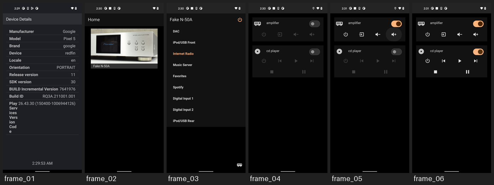

All published screenshots:

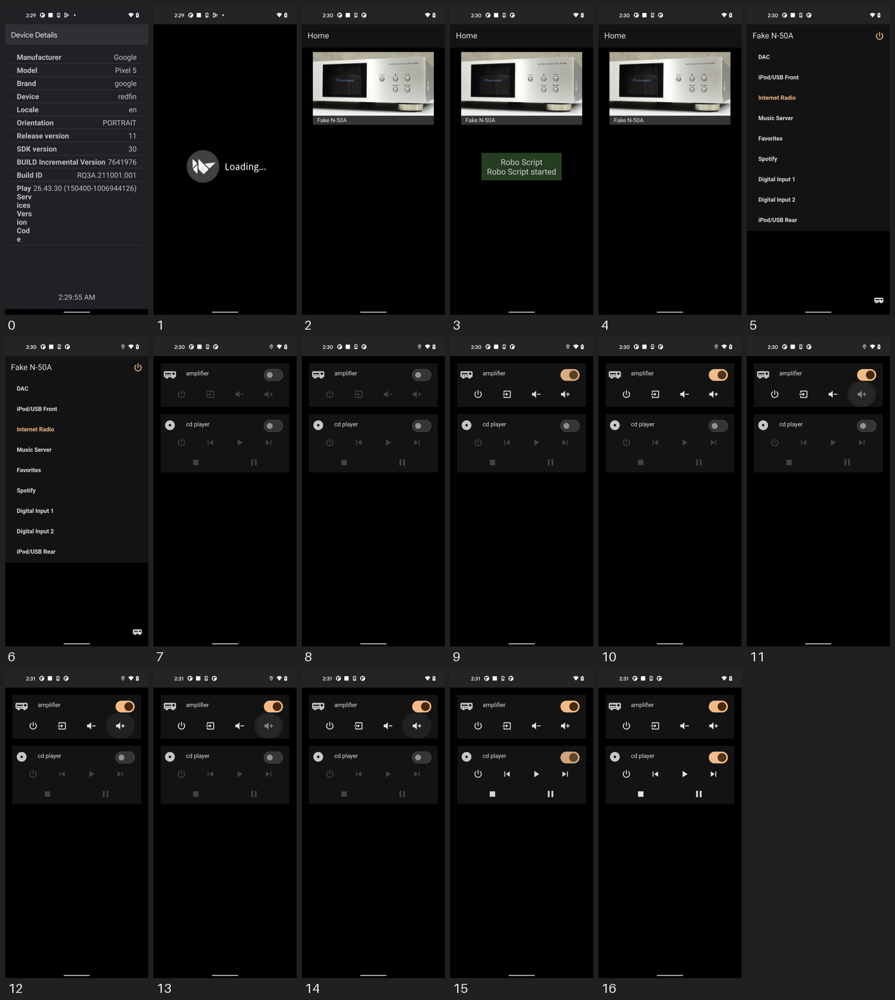

[0](https://raw.githubusercontent.com/AccelQuasarDragon/kivy-helper-repro/shots/shots/44285595799/0.png) [1](https://raw.githubusercontent.com/AccelQuasarDragon/kivy-helper-repro/shots/shots/44285595799/1.png) [2](https://raw.githubusercontent.com/AccelQuasarDragon/kivy-helper-repro/shots/shots/44285595799/2.png) [3](https://raw.githubusercontent.com/AccelQuasarDragon/kivy-helper-repro/shots/shots/44285595799/3.png) [4](https://raw.githubusercontent.com/AccelQuasarDragon/kivy-helper-repro/shots/shots/44285595799/4.png) [5](https://raw.githubusercontent.com/AccelQuasarDragon/kivy-helper-repro/shots/shots/44285595799/5.png) [6](https://raw.githubusercontent.com/AccelQuasarDragon/kivy-helper-repro/shots/shots/44285595799/6.png) [7](https://raw.githubusercontent.com/AccelQuasarDragon/kivy-helper-repro/shots/shots/44285595799/7.png) [8](https://raw.githubusercontent.com/AccelQuasarDragon/kivy-helper-repro/shots/shots/44285595799/8.png) [9](https://raw.githubusercontent.com/AccelQuasarDragon/kivy-helper-repro/shots/shots/44285595799/9.png) [10](https://raw.githubusercontent.com/AccelQuasarDragon/kivy-helper-repro/shots/shots/44285595799/10.png) [11](https://raw.githubusercontent.com/AccelQuasarDragon/kivy-helper-repro/shots/shots/44285595799/11.png) [12](https://raw.githubusercontent.com/AccelQuasarDragon/kivy-helper-repro/shots/shots/44285595799/12.png) [13](https://raw.githubusercontent.com/AccelQuasarDragon/kivy-helper-repro/shots/shots/44285595799/13.png) [14](https://raw.githubusercontent.com/AccelQuasarDragon/kivy-helper-repro/shots/shots/44285595799/14.png) [15](https://raw.githubusercontent.com/AccelQuasarDragon/kivy-helper-repro/shots/shots/44285595799/15.png) [16](https://raw.githubusercontent.com/AccelQuasarDragon/kivy-helper-repro/shots/shots/44285595799/16.png)

<a id="run-44501582277"></a>

### B0S shipped ripple, shadows on · 🔴 CRASH

| Field | Value |
|---|---|
| **Result** | 🔴 **CRASH** SIGSEGV 0x40 in libGLESv2\_adreno\.so 0\.36 s after the top\-bar power tap \(its own ripple, no list\), same backtrace as S0\. |
| **What we learned** | Any first ripple crashes, not only list rows\. |
| **Question** | Fresh shadows\-on build, ripple as shipped, power button first:​ crash? |
| **Where it ran** | Physical phone in Google Firebase Test Lab \(devicelab\.yml\):​ device redfin\-30\-en\-portrait, not an emulator |
| **Settings** | artifact build\-6\-B0S\-a1 of run 44324237484 · device redfin API 30 |
| **Test Lab** | device redfin\-30\-en\-portrait · Test Lab outcome Failed \(Application crashed\) · test time 84 s · 8 screenshot\(s\) · video 88 s · 2 crash report file\(s\) · 5 scripted tap\(s\) |
| **Evidence** | APK · proven |
| **Links** | [Actions run](https://github.com/AccelQuasarDragon/kivy-helper-repro/actions/runs/44501582277) · [how to recreate](#recreate-run-44501582277) |

Video: [video\.mp4](https://accelquasardragon.github.io/kivy-helper-repro/shots/44501582277/video.mp4)

Frames sampled from the video:

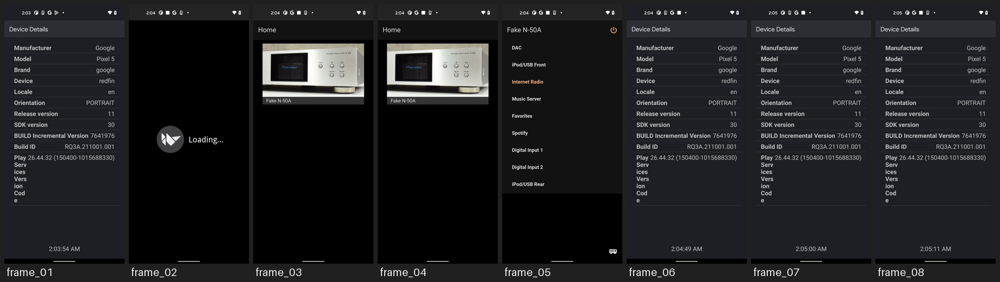

All published screenshots:

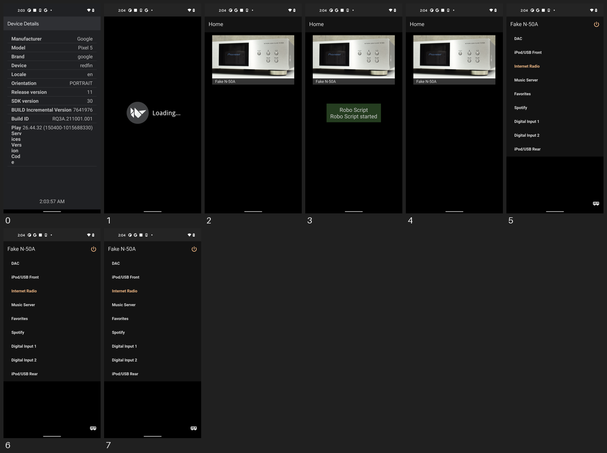

[0](https://raw.githubusercontent.com/AccelQuasarDragon/kivy-helper-repro/shots/shots/44501582277/0.png) [1](https://raw.githubusercontent.com/AccelQuasarDragon/kivy-helper-repro/shots/shots/44501582277/1.png) [2](https://raw.githubusercontent.com/AccelQuasarDragon/kivy-helper-repro/shots/shots/44501582277/2.png) [3](https://raw.githubusercontent.com/AccelQuasarDragon/kivy-helper-repro/shots/shots/44501582277/3.png) [4](https://raw.githubusercontent.com/AccelQuasarDragon/kivy-helper-repro/shots/shots/44501582277/4.png) [5](https://raw.githubusercontent.com/AccelQuasarDragon/kivy-helper-repro/shots/shots/44501582277/5.png) [6](https://raw.githubusercontent.com/AccelQuasarDragon/kivy-helper-repro/shots/shots/44501582277/6.png) [7](https://raw.githubusercontent.com/AccelQuasarDragon/kivy-helper-repro/shots/shots/44501582277/7.png)

<a id="run-44589140589"></a>

### R1 KivyMD PR \#1907 · 🔴 CRASH

| Field | Value |
|---|---|
| **Result** | 🔴 **CRASH** SIGSEGV 0x40, adreno x4 &lt;\- vbo &lt;\- instructions &lt;\- compiler, 353 ms after the first power tap\. |
| **What we learned** | \#1907 fixes the 0\-px Fbo error, not this crash\. |
| **Question** | KivyMD PR \#1907 \(dp\(1\) Fbo \+ clamp, shader still set late\):​ crash? |
| **Where it ran** | Physical phone in Google Firebase Test Lab \(devicelab\.yml\):​ device redfin\-30\-en\-portrait, not an emulator |
| **Settings** | artifact build\-7\-P1907\-a1 of run 44580816339 · device redfin API 30 |
| **Test Lab** | device redfin\-30\-en\-portrait · Test Lab outcome Failed \(Application crashed\) · test time 106 s · 8 screenshot\(s\) · video 110 s · 2 crash report file\(s\) · 7 scripted tap\(s\) |
| **Evidence** | APK · proven |
| **Links** | [Actions run](https://github.com/AccelQuasarDragon/kivy-helper-repro/actions/runs/44589140589) · [how to recreate](#recreate-run-44589140589) |

Video: [video\.mp4](https://accelquasardragon.github.io/kivy-helper-repro/shots/44589140589/video.mp4)

Frames sampled from the video:

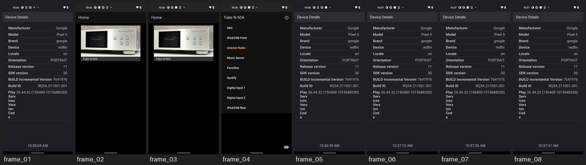

All published screenshots:


[0](https://raw.githubusercontent.com/AccelQuasarDragon/kivy-helper-repro/shots/shots/44589140589/0.png) [1](https://raw.githubusercontent.com/AccelQuasarDragon/kivy-helper-repro/shots/shots/44589140589/1.png) [2](https://raw.githubusercontent.com/AccelQuasarDragon/kivy-helper-repro/shots/shots/44589140589/2.png) [3](https://raw.githubusercontent.com/AccelQuasarDragon/kivy-helper-repro/shots/shots/44589140589/3.png) [4](https://raw.githubusercontent.com/AccelQuasarDragon/kivy-helper-repro/shots/shots/44589140589/4.png) [5](https://raw.githubusercontent.com/AccelQuasarDragon/kivy-helper-repro/shots/shots/44589140589/5.png) [6](https://raw.githubusercontent.com/AccelQuasarDragon/kivy-helper-repro/shots/shots/44589140589/6.png) [7](https://raw.githubusercontent.com/AccelQuasarDragon/kivy-helper-repro/shots/shots/44589140589/7.png)

<a id="run-44590309751"></a>

### R2 KivyMD fs= fix, power x2 · 🟢 CLEAN

| Field | Value |
|---|---|
| **Result** | 🟢 **CLEAN** power x2 \(ripple circle drawn behind the icon\), then Music Server row \-&gt; album list \-&gt; back, twice\. |
| **What we learned** | The fix inside KivyMD stops the crash, and the ripple still draws\. |
| **Question** | KivyMD fork e0f0ca0 \(Fbo created with fs=\), same taps as R1:​ crash? |
| **Where it ran** | Physical phone in Google Firebase Test Lab \(devicelab\.yml\):​ device redfin\-30\-en\-portrait, not an emulator |
| **Settings** | artifact build\-7\-PRFS\-a1 of run 44580816339 · device redfin API 30 |
| **Test Lab** | device redfin\-30\-en\-portrait · Test Lab outcome Passed · test time 102 s · 17 screenshot\(s\) · video 106 s · 0 crash report file\(s\) · 7 scripted tap\(s\) |
| **Evidence** | APK · proven |
| **Links** | [Actions run](https://github.com/AccelQuasarDragon/kivy-helper-repro/actions/runs/44590309751) · [how to recreate](#recreate-run-44590309751) |

Video: [video\.mp4](https://accelquasardragon.github.io/kivy-helper-repro/shots/44590309751/video.mp4)

Frames sampled from the video:

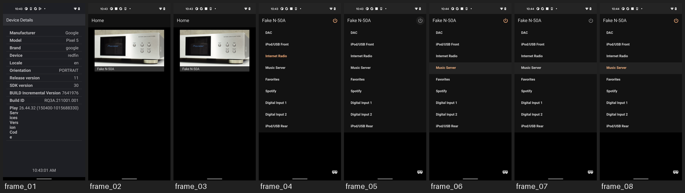

All published screenshots:

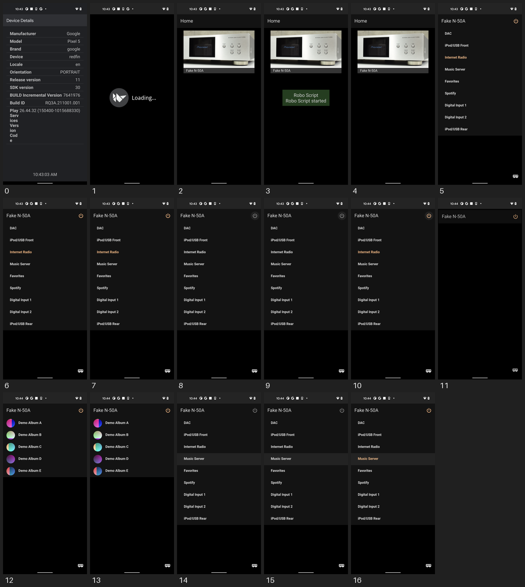

[0](https://raw.githubusercontent.com/AccelQuasarDragon/kivy-helper-repro/shots/shots/44590309751/0.png) [1](https://raw.githubusercontent.com/AccelQuasarDragon/kivy-helper-repro/shots/shots/44590309751/1.png) [2](https://raw.githubusercontent.com/AccelQuasarDragon/kivy-helper-repro/shots/shots/44590309751/2.png) [3](https://raw.githubusercontent.com/AccelQuasarDragon/kivy-helper-repro/shots/shots/44590309751/3.png) [4](https://raw.githubusercontent.com/AccelQuasarDragon/kivy-helper-repro/shots/shots/44590309751/4.png) [5](https://raw.githubusercontent.com/AccelQuasarDragon/kivy-helper-repro/shots/shots/44590309751/5.png) [6](https://raw.githubusercontent.com/AccelQuasarDragon/kivy-helper-repro/shots/shots/44590309751/6.png) [7](https://raw.githubusercontent.com/AccelQuasarDragon/kivy-helper-repro/shots/shots/44590309751/7.png) [8](https://raw.githubusercontent.com/AccelQuasarDragon/kivy-helper-repro/shots/shots/44590309751/8.png) [9](https://raw.githubusercontent.com/AccelQuasarDragon/kivy-helper-repro/shots/shots/44590309751/9.png) [10](https://raw.githubusercontent.com/AccelQuasarDragon/kivy-helper-repro/shots/shots/44590309751/10.png) [11](https://raw.githubusercontent.com/AccelQuasarDragon/kivy-helper-repro/shots/shots/44590309751/11.png) [12](https://raw.githubusercontent.com/AccelQuasarDragon/kivy-helper-repro/shots/shots/44590309751/12.png) [13](https://raw.githubusercontent.com/AccelQuasarDragon/kivy-helper-repro/shots/shots/44590309751/13.png) [14](https://raw.githubusercontent.com/AccelQuasarDragon/kivy-helper-repro/shots/shots/44590309751/14.png) [15](https://raw.githubusercontent.com/AccelQuasarDragon/kivy-helper-repro/shots/shots/44590309751/15.png) [16](https://raw.githubusercontent.com/AccelQuasarDragon/kivy-helper-repro/shots/shots/44590309751/16.png)

<a id="run-44591562998"></a>

### R3 fs= fix, list row x3 · 🟢 CLEAN

| Field | Value |
|---|---|
| **Result** | 🟢 **CLEAN** three list\-row ripples, no tombstone, no fatal signal\. |
| **What we learned** | List\-row ripples are fine with the fix\. |
| **Question** | Fork e0f0ca0, list\-row ripple three times with leave/return:​ crash? |
| **Where it ran** | Physical phone in Google Firebase Test Lab \(devicelab\.yml\):​ device redfin\-30\-en\-portrait, not an emulator |
| **Settings** | artifact build\-7\-PRFS\-a1 of run 44580816339 · device redfin API 30 |
| **Test Lab** | device redfin\-30\-en\-portrait · Test Lab outcome Passed · test time 105 s · 17 screenshot\(s\) · video 97 s · 0 crash report file\(s\) · 7 scripted tap\(s\) |
| **Evidence** | APK · proven |
| **Links** | [Actions run](https://github.com/AccelQuasarDragon/kivy-helper-repro/actions/runs/44591562998) · [how to recreate](#recreate-run-44591562998) |

Video: [video\.mp4](https://accelquasardragon.github.io/kivy-helper-repro/shots/44591562998/video.mp4)

Frames sampled from the video:

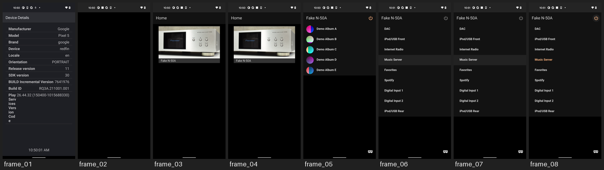

All published screenshots:

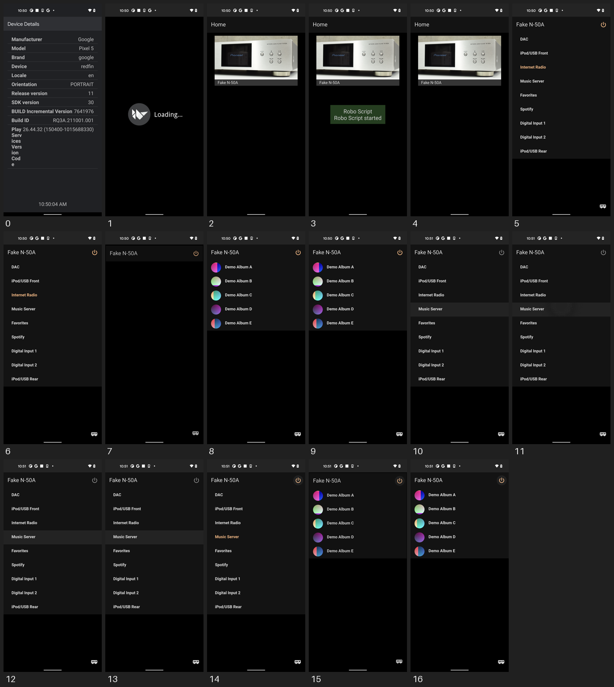

[0](https://raw.githubusercontent.com/AccelQuasarDragon/kivy-helper-repro/shots/shots/44591562998/0.png) [1](https://raw.githubusercontent.com/AccelQuasarDragon/kivy-helper-repro/shots/shots/44591562998/1.png) [2](https://raw.githubusercontent.com/AccelQuasarDragon/kivy-helper-repro/shots/shots/44591562998/2.png) [3](https://raw.githubusercontent.com/AccelQuasarDragon/kivy-helper-repro/shots/shots/44591562998/3.png) [4](https://raw.githubusercontent.com/AccelQuasarDragon/kivy-helper-repro/shots/shots/44591562998/4.png) [5](https://raw.githubusercontent.com/AccelQuasarDragon/kivy-helper-repro/shots/shots/44591562998/5.png) [6](https://raw.githubusercontent.com/AccelQuasarDragon/kivy-helper-repro/shots/shots/44591562998/6.png) [7](https://raw.githubusercontent.com/AccelQuasarDragon/kivy-helper-repro/shots/shots/44591562998/7.png) [8](https://raw.githubusercontent.com/AccelQuasarDragon/kivy-helper-repro/shots/shots/44591562998/8.png) [9](https://raw.githubusercontent.com/AccelQuasarDragon/kivy-helper-repro/shots/shots/44591562998/9.png) [10](https://raw.githubusercontent.com/AccelQuasarDragon/kivy-helper-repro/shots/shots/44591562998/10.png) [11](https://raw.githubusercontent.com/AccelQuasarDragon/kivy-helper-repro/shots/shots/44591562998/11.png) [12](https://raw.githubusercontent.com/AccelQuasarDragon/kivy-helper-repro/shots/shots/44591562998/12.png) [13](https://raw.githubusercontent.com/AccelQuasarDragon/kivy-helper-repro/shots/shots/44591562998/13.png) [14](https://raw.githubusercontent.com/AccelQuasarDragon/kivy-helper-repro/shots/shots/44591562998/14.png) [15](https://raw.githubusercontent.com/AccelQuasarDragon/kivy-helper-repro/shots/shots/44591562998/15.png) [16](https://raw.githubusercontent.com/AccelQuasarDragon/kivy-helper-repro/shots/shots/44591562998/16.png)

<a id="run-44592679382"></a>

### R4 fs= fix, other devices · 🟢 CLEAN

| Field | Value |
|---|---|
| **Result** | 🟢 **CLEAN** other\_devices reached, switch and icon\-button ripples, no fatal signal\. |
| **What we learned** | The screen you reported is clean with the fix\. |
| **Question** | Fork e0f0ca0, the other\-devices taps \(switches, volume\-plus x2\):​ crash? |
| **Where it ran** | Physical phone in Google Firebase Test Lab \(devicelab\.yml\):​ device redfin\-30\-en\-portrait, not an emulator |
| **Settings** | artifact build\-7\-PRFS\-a1 of run 44580816339 · device redfin API 30 |
| **Test Lab** | device redfin\-30\-en\-portrait · Test Lab outcome Passed · 17 screenshot\(s\) · video 97 s · 0 crash report file\(s\) · 7 scripted tap\(s\) |
| **Evidence** | APK · proven |
| **Links** | [Actions run](https://github.com/AccelQuasarDragon/kivy-helper-repro/actions/runs/44592679382) · [how to recreate](#recreate-run-44592679382) |

Video: [video\.mp4](https://accelquasardragon.github.io/kivy-helper-repro/shots/44592679382/video.mp4)

Frames sampled from the video:

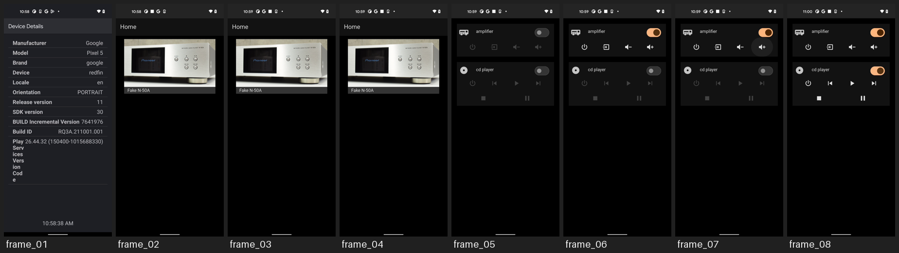

All published screenshots:


[0](https://raw.githubusercontent.com/AccelQuasarDragon/kivy-helper-repro/shots/shots/44592679382/0.png) [1](https://raw.githubusercontent.com/AccelQuasarDragon/kivy-helper-repro/shots/shots/44592679382/1.png) [2](https://raw.githubusercontent.com/AccelQuasarDragon/kivy-helper-repro/shots/shots/44592679382/2.png) [3](https://raw.githubusercontent.com/AccelQuasarDragon/kivy-helper-repro/shots/shots/44592679382/3.png) [4](https://raw.githubusercontent.com/AccelQuasarDragon/kivy-helper-repro/shots/shots/44592679382/4.png) [5](https://raw.githubusercontent.com/AccelQuasarDragon/kivy-helper-repro/shots/shots/44592679382/5.png) [6](https://raw.githubusercontent.com/AccelQuasarDragon/kivy-helper-repro/shots/shots/44592679382/6.png) [7](https://raw.githubusercontent.com/AccelQuasarDragon/kivy-helper-repro/shots/shots/44592679382/7.png) [8](https://raw.githubusercontent.com/AccelQuasarDragon/kivy-helper-repro/shots/shots/44592679382/8.png) [9](https://raw.githubusercontent.com/AccelQuasarDragon/kivy-helper-repro/shots/shots/44592679382/9.png) [10](https://raw.githubusercontent.com/AccelQuasarDragon/kivy-helper-repro/shots/shots/44592679382/10.png) [11](https://raw.githubusercontent.com/AccelQuasarDragon/kivy-helper-repro/shots/shots/44592679382/11.png) [12](https://raw.githubusercontent.com/AccelQuasarDragon/kivy-helper-repro/shots/shots/44592679382/12.png) [13](https://raw.githubusercontent.com/AccelQuasarDragon/kivy-helper-repro/shots/shots/44592679382/13.png) [14](https://raw.githubusercontent.com/AccelQuasarDragon/kivy-helper-repro/shots/shots/44592679382/14.png) [15](https://raw.githubusercontent.com/AccelQuasarDragon/kivy-helper-repro/shots/shots/44592679382/15.png) [16](https://raw.githubusercontent.com/AccelQuasarDragon/kivy-helper-repro/shots/shots/44592679382/16.png)

<a id="run-44716239758"></a>

### D1 shipped ripple, Galaxy A52 · 🔴 CRASH

| Field | Value |
|---|---|
| **Result** | 🔴 **CRASH** SIGSEGV 0x40 about 120 ms after the Music Server row tap, same backtrace as on the Pixel 5\. |
| **What we learned** | A second Adreno GPU \(619\) crashes the same way\. |
| **Question** | Shipped KivyMD \(a00c10c\) on a Galaxy A52 5G \(Adreno 619, Android 14\):​ crash? |
| **Where it ran** | Physical phone in Google Firebase Test Lab \(devicelab\.yml\):​ device a52xq\-34\-en\-portrait, not an emulator |
| **Settings** | artifact build\-7\-C0\-a1 of run 44580816339 · device a52xq API 34 |
| **Test Lab** | device a52xq\-34\-en\-portrait · Test Lab outcome Failed \(Application crashed\) · test time 84 s · 8 screenshot\(s\) · video 91 s · 2 crash report file\(s\) · 4 scripted tap\(s\) |
| **Evidence** | APK · proven |
| **Links** | [Actions run](https://github.com/AccelQuasarDragon/kivy-helper-repro/actions/runs/44716239758) · [how to recreate](#recreate-run-44716239758) |

Video: [video\.mp4](https://accelquasardragon.github.io/kivy-helper-repro/shots/44716239758/video.mp4)

Frames sampled from the video:

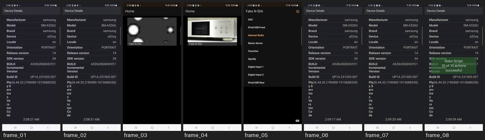

All published screenshots:

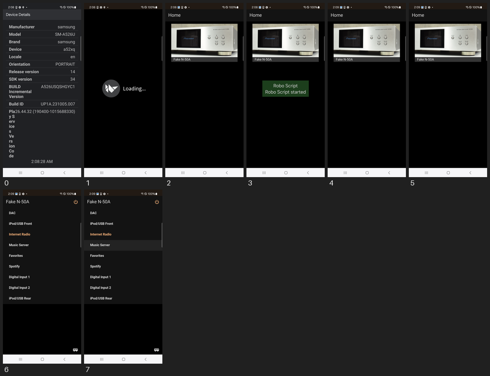

[0](https://raw.githubusercontent.com/AccelQuasarDragon/kivy-helper-repro/shots/shots/44716239758/0.png) [1](https://raw.githubusercontent.com/AccelQuasarDragon/kivy-helper-repro/shots/shots/44716239758/1.png) [2](https://raw.githubusercontent.com/AccelQuasarDragon/kivy-helper-repro/shots/shots/44716239758/2.png) [3](https://raw.githubusercontent.com/AccelQuasarDragon/kivy-helper-repro/shots/shots/44716239758/3.png) [4](https://raw.githubusercontent.com/AccelQuasarDragon/kivy-helper-repro/shots/shots/44716239758/4.png) [5](https://raw.githubusercontent.com/AccelQuasarDragon/kivy-helper-repro/shots/shots/44716239758/5.png) [6](https://raw.githubusercontent.com/AccelQuasarDragon/kivy-helper-repro/shots/shots/44716239758/6.png) [7](https://raw.githubusercontent.com/AccelQuasarDragon/kivy-helper-repro/shots/shots/44716239758/7.png)

<a id="run-44717304020"></a>

### D2 fs= fix, Galaxy A52 · 🟢 CLEAN

| Field | Value |
|---|---|
| **Result** | 🟢 **CLEAN** reached the track list, no fatal signal\. |
| **What we learned** | The fix holds on the Adreno 619\. |
| **Question** | Fork e0f0ca0 APK, same taps on the Galaxy A52:​ crash? |
| **Where it ran** | Physical phone in Google Firebase Test Lab \(devicelab\.yml\):​ device a52xq\-34\-en\-portrait, not an emulator |
| **Settings** | artifact build\-7\-PRFS\-a1 of run 44580816339 · device a52xq API 34 |
| **Test Lab** | device a52xq\-34\-en\-portrait · Test Lab outcome Passed · 11 screenshot\(s\) · video 86 s · 0 crash report file\(s\) · 4 scripted tap\(s\) |
| **Evidence** | APK · proven |
| **Links** | [Actions run](https://github.com/AccelQuasarDragon/kivy-helper-repro/actions/runs/44717304020) · [how to recreate](#recreate-run-44717304020) |

Video: [video\.mp4](https://accelquasardragon.github.io/kivy-helper-repro/shots/44717304020/video.mp4)

Frames sampled from the video:

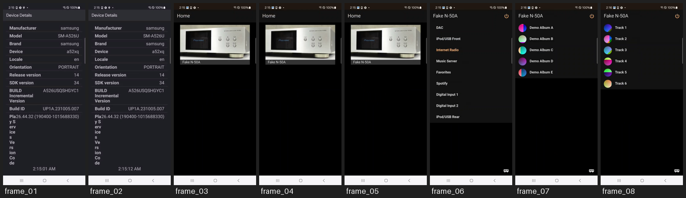

All published screenshots:

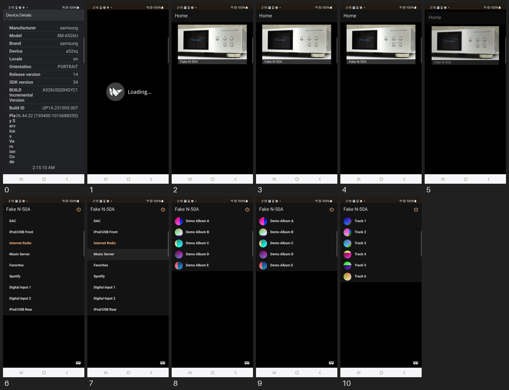

[0](https://raw.githubusercontent.com/AccelQuasarDragon/kivy-helper-repro/shots/shots/44717304020/0.png) [1](https://raw.githubusercontent.com/AccelQuasarDragon/kivy-helper-repro/shots/shots/44717304020/1.png) [2](https://raw.githubusercontent.com/AccelQuasarDragon/kivy-helper-repro/shots/shots/44717304020/2.png) [3](https://raw.githubusercontent.com/AccelQuasarDragon/kivy-helper-repro/shots/shots/44717304020/3.png) [4](https://raw.githubusercontent.com/AccelQuasarDragon/kivy-helper-repro/shots/shots/44717304020/4.png) [5](https://raw.githubusercontent.com/AccelQuasarDragon/kivy-helper-repro/shots/shots/44717304020/5.png) [6](https://raw.githubusercontent.com/AccelQuasarDragon/kivy-helper-repro/shots/shots/44717304020/6.png) [7](https://raw.githubusercontent.com/AccelQuasarDragon/kivy-helper-repro/shots/shots/44717304020/7.png) [8](https://raw.githubusercontent.com/AccelQuasarDragon/kivy-helper-repro/shots/shots/44717304020/8.png) [9](https://raw.githubusercontent.com/AccelQuasarDragon/kivy-helper-repro/shots/shots/44717304020/9.png) [10](https://raw.githubusercontent.com/AccelQuasarDragon/kivy-helper-repro/shots/shots/44717304020/10.png)

<a id="run-44718163639"></a>

### D3 fs= fix, Galaxy A52, repeat · 🟢 CLEAN

| Field | Value |
|---|---|
| **Result** | 🟢 **CLEAN** reached the track list, no fatal signal\. |
| **What we learned** | Clean 2 of 2 on the A52\. |
| **Question** | D2 again:​ still clean? |
| **Where it ran** | Physical phone in Google Firebase Test Lab \(devicelab\.yml\):​ device a52xq\-34\-en\-portrait, not an emulator |
| **Settings** | artifact build\-7\-PRFS\-a1 of run 44580816339 · device a52xq API 34 |
| **Test Lab** | device a52xq\-34\-en\-portrait · Test Lab outcome Passed · test time 80 s · 11 screenshot\(s\) · video 86 s · 0 crash report file\(s\) · 4 scripted tap\(s\) |
| **Evidence** | APK · proven |
| **Links** | [Actions run](https://github.com/AccelQuasarDragon/kivy-helper-repro/actions/runs/44718163639) · [how to recreate](#recreate-run-44718163639) |

Video: [video\.mp4](https://accelquasardragon.github.io/kivy-helper-repro/shots/44718163639/video.mp4)

Frames sampled from the video:

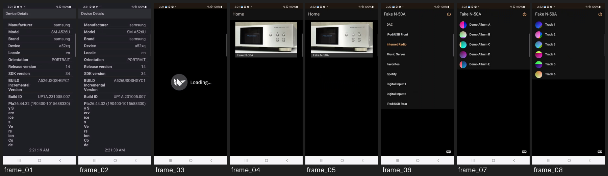

All published screenshots:

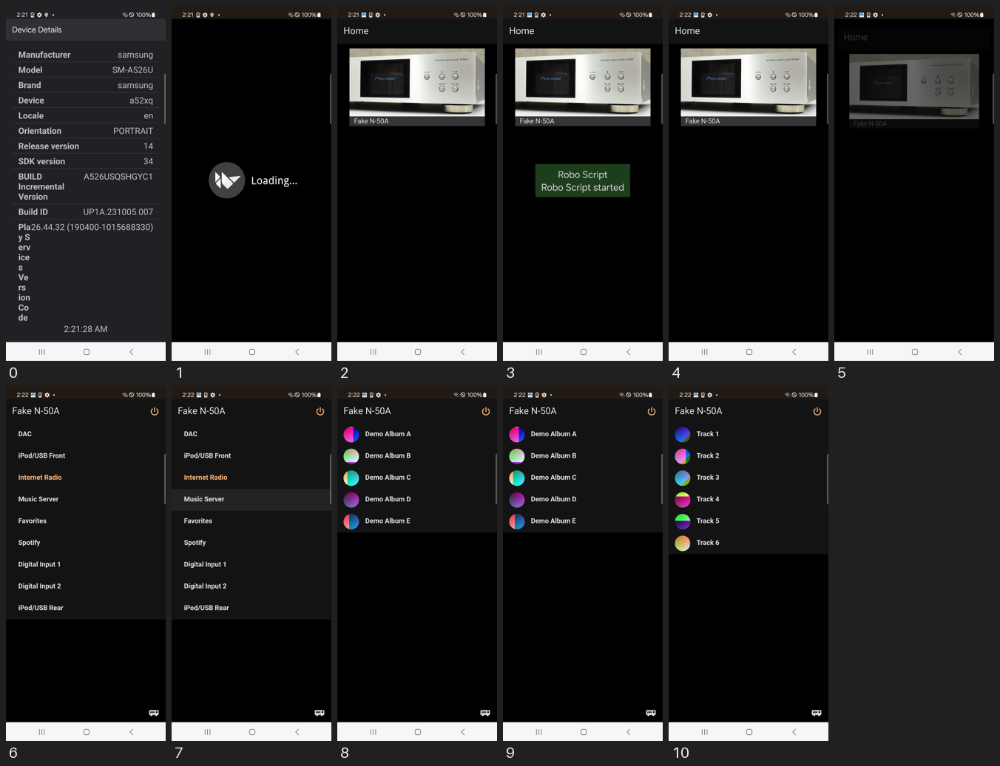

[0](https://raw.githubusercontent.com/AccelQuasarDragon/kivy-helper-repro/shots/shots/44718163639/0.png) [1](https://raw.githubusercontent.com/AccelQuasarDragon/kivy-helper-repro/shots/shots/44718163639/1.png) [2](https://raw.githubusercontent.com/AccelQuasarDragon/kivy-helper-repro/shots/shots/44718163639/2.png) [3](https://raw.githubusercontent.com/AccelQuasarDragon/kivy-helper-repro/shots/shots/44718163639/3.png) [4](https://raw.githubusercontent.com/AccelQuasarDragon/kivy-helper-repro/shots/shots/44718163639/4.png) [5](https://raw.githubusercontent.com/AccelQuasarDragon/kivy-helper-repro/shots/shots/44718163639/5.png) [6](https://raw.githubusercontent.com/AccelQuasarDragon/kivy-helper-repro/shots/shots/44718163639/6.png) [7](https://raw.githubusercontent.com/AccelQuasarDragon/kivy-helper-repro/shots/shots/44718163639/7.png) [8](https://raw.githubusercontent.com/AccelQuasarDragon/kivy-helper-repro/shots/shots/44718163639/8.png) [9](https://raw.githubusercontent.com/AccelQuasarDragon/kivy-helper-repro/shots/shots/44718163639/9.png) [10](https://raw.githubusercontent.com/AccelQuasarDragon/kivy-helper-repro/shots/shots/44718163639/10.png)

<a id="run-44719013412"></a>

### mC0 minimal app, shipped ripple

| Field | Value |
|---|---|
| **Result** | CRASH during its first ripple \(top\-bar button tap\), same backtrace\. |
| **What we learned** | KivyMD alone is enough to crash:​ no controlP code needed\. |
| **Question** | A \~200\-line KivyMD\-only app \(none of your code\), shipped KivyMD a00c10c:​ crash? |
| **Where it ran** | Physical phone in Google Firebase Test Lab \(devicelab\.yml\):​ device redfin\-30\-en\-portrait, not an emulator |
| **Settings** | artifact build\-8\-mC0\-a1 of run 44584005765 · device redfin API 30 |
| **Test Lab** | device redfin\-30\-en\-portrait · Test Lab outcome Failed \(Application crashed\) · test time 105 s · 6 screenshot\(s\) · video 109 s · 2 crash report file\(s\) · 7 scripted tap\(s\) |
| **Evidence** | APK · proven |
| **Links** | [Actions run](https://github.com/AccelQuasarDragon/kivy-helper-repro/actions/runs/44719013412) · [how to recreate](#recreate-run-44719013412) |

Video: [video\.mp4](https://accelquasardragon.github.io/kivy-helper-repro/shots/44719013412/video.mp4)

Frames sampled from the video:

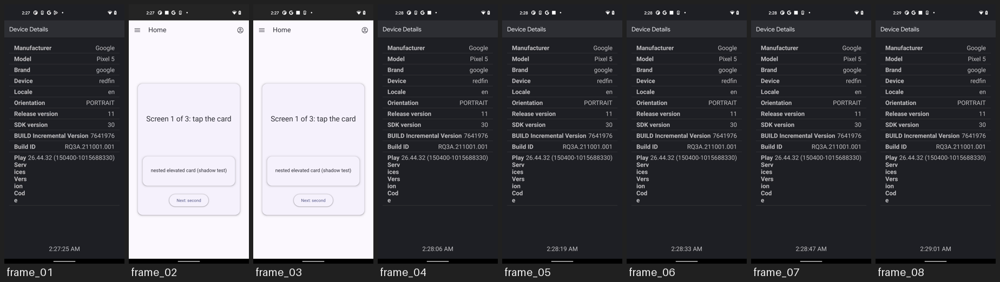

All published screenshots:

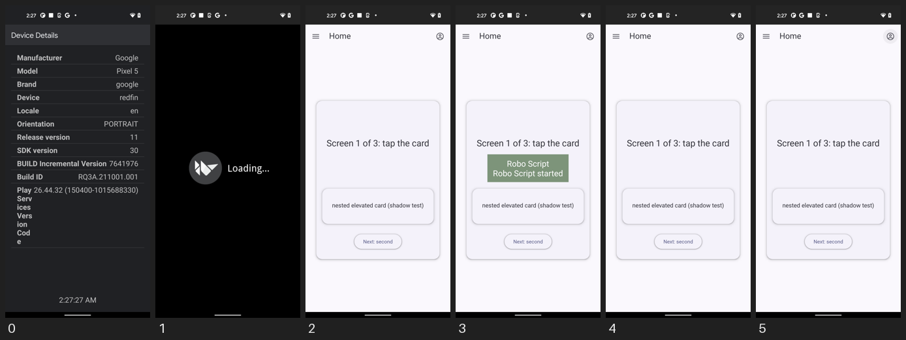

[0](https://raw.githubusercontent.com/AccelQuasarDragon/kivy-helper-repro/shots/shots/44719013412/0.png) [1](https://raw.githubusercontent.com/AccelQuasarDragon/kivy-helper-repro/shots/shots/44719013412/1.png) [2](https://raw.githubusercontent.com/AccelQuasarDragon/kivy-helper-repro/shots/shots/44719013412/2.png) [3](https://raw.githubusercontent.com/AccelQuasarDragon/kivy-helper-repro/shots/shots/44719013412/3.png) [4](https://raw.githubusercontent.com/AccelQuasarDragon/kivy-helper-repro/shots/shots/44719013412/4.png) [5](https://raw.githubusercontent.com/AccelQuasarDragon/kivy-helper-repro/shots/shots/44719013412/5.png)

<a id="run-44719993437"></a>

### mPRFS minimal app, fs= fix · 🟢 CLEAN

| Field | Value |
|---|---|
| **Result** | 🟢 **CLEAN** home, second, third, home, second; top\-bar ripple x2, no fatal signal\. |
| **What we learned** | The fix works in the minimal app too\. |
| **Question** | Same minimal app with fork e0f0ca0:​ crash? |
| **Where it ran** | Physical phone in Google Firebase Test Lab \(devicelab\.yml\):​ device redfin\-30\-en\-portrait, not an emulator |
| **Settings** | artifact build\-8\-mPRFS\-a1 of run 44584005765 · device redfin API 30 |
| **Test Lab** | device redfin\-30\-en\-portrait · Test Lab outcome Passed · test time 97 s · 17 screenshot\(s\) · video 90 s · 0 crash report file\(s\) · 7 scripted tap\(s\) |
| **Evidence** | APK · proven |
| **Links** | [Actions run](https://github.com/AccelQuasarDragon/kivy-helper-repro/actions/runs/44719993437) · [how to recreate](#recreate-run-44719993437) |

Video: [video\.mp4](https://accelquasardragon.github.io/kivy-helper-repro/shots/44719993437/video.mp4)

Frames sampled from the video:

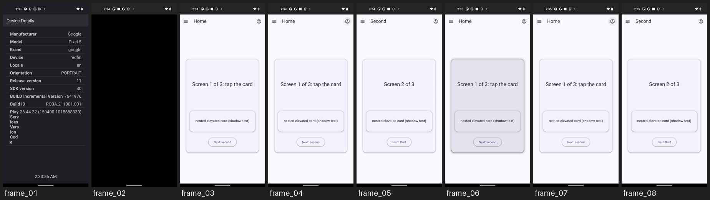

All published screenshots:

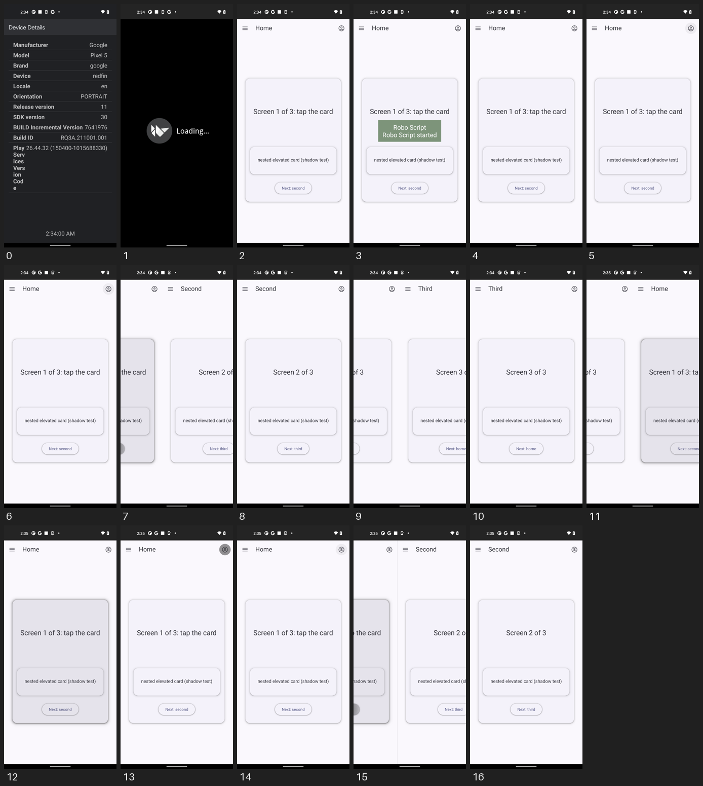

[0](https://raw.githubusercontent.com/AccelQuasarDragon/kivy-helper-repro/shots/shots/44719993437/0.png) [1](https://raw.githubusercontent.com/AccelQuasarDragon/kivy-helper-repro/shots/shots/44719993437/1.png) [2](https://raw.githubusercontent.com/AccelQuasarDragon/kivy-helper-repro/shots/shots/44719993437/2.png) [3](https://raw.githubusercontent.com/AccelQuasarDragon/kivy-helper-repro/shots/shots/44719993437/3.png) [4](https://raw.githubusercontent.com/AccelQuasarDragon/kivy-helper-repro/shots/shots/44719993437/4.png) [5](https://raw.githubusercontent.com/AccelQuasarDragon/kivy-helper-repro/shots/shots/44719993437/5.png) [6](https://raw.githubusercontent.com/AccelQuasarDragon/kivy-helper-repro/shots/shots/44719993437/6.png) [7](https://raw.githubusercontent.com/AccelQuasarDragon/kivy-helper-repro/shots/shots/44719993437/7.png) [8](https://raw.githubusercontent.com/AccelQuasarDragon/kivy-helper-repro/shots/shots/44719993437/8.png) [9](https://raw.githubusercontent.com/AccelQuasarDragon/kivy-helper-repro/shots/shots/44719993437/9.png) [10](https://raw.githubusercontent.com/AccelQuasarDragon/kivy-helper-repro/shots/shots/44719993437/10.png) [11](https://raw.githubusercontent.com/AccelQuasarDragon/kivy-helper-repro/shots/shots/44719993437/11.png) [12](https://raw.githubusercontent.com/AccelQuasarDragon/kivy-helper-repro/shots/shots/44719993437/12.png) [13](https://raw.githubusercontent.com/AccelQuasarDragon/kivy-helper-repro/shots/shots/44719993437/13.png) [14](https://raw.githubusercontent.com/AccelQuasarDragon/kivy-helper-repro/shots/shots/44719993437/14.png) [15](https://raw.githubusercontent.com/AccelQuasarDragon/kivy-helper-repro/shots/shots/44719993437/15.png) [16](https://raw.githubusercontent.com/AccelQuasarDragon/kivy-helper-repro/shots/shots/44719993437/16.png)

## What crashes

The crash is in KivyMD's M3 ripple, not in your code and not in BoxShadow\.

In KivyMD master \(a00c10c\) list items, icon buttons and switches all use M3CommonRipple \(the old ripple classes are aliases of it\)\.

Its init\_fbos creates an Fbo, then set\_shader assigns shader\.fs on it:​ the order kivy/kivy\#8098 found breaks on Adreno, fixed there by passing fs= to Fbo\(\)\.

On both phones the app died a few ms after a ripple drew, in libGLESv2\_adreno\.so under Kivy's fbo / vbo code\.

- [kivy/kivy\#8098](https://github.com/kivy/kivy/pull/8098)
- [kivymd/KivyMD\#1900](https://github.com/kivymd/KivyMD/issues/1900)

## What we changed, one thing per run \(Nov 18\)

Nov 18, Pixel 5 \(Android 11\) in Google Firebase Test Lab via our devicelab\.yml flow, not an emulator; your cad5d5c with an offline demo device\.

S0 = shipped config \(shadows off\)\. T1, T2, W, OD = one later shadows\-ON build, each changing one ripple setting via app\_config\.json\.

- [bisect toggles \(patch\)](https://github.com/AccelQuasarDragon/kivy-helper-repro/blob/main/patches/controlp/bisect_toggles.diff)
- [how the bisect works](https://github.com/AccelQuasarDragon/kivy-helper-repro/blob/main/docs/bisect.md)

## How we got here:​ flow 1, bottom\-up \(Nov 17\)

Flow 1, bottom\-up \(Nov 17\):​ DL1 full app on the Pixel 5 = CRASH\. A 5\-APK kit of stock widgets \(BIS5:​ KivyMD \+ BoxShadow, 20 screen switches\) = CLEAN\. DL1 again = CRASH, so the trigger is in the app, not in stock widgets alone\. We switched to top\-down\.

- [DL1](https://github.com/AccelQuasarDragon/kivy-helper-repro/actions/runs/44154307029)
- [BIS5](https://github.com/AccelQuasarDragon/kivy-helper-repro/actions/runs/44153044950)

## How we got here:​ flow 2, top\-down \(Nov 17\-18\)

Flow 2, top\-down \(Nov 17\):​ switch groups of your UI off\. B1 \(input\-list effects \+ Explore list off\) = CLEAN\. B3 \(input\-list effects off only\) = CRASH, but it moved to the first tap on an Explore row that still had its ripple\.

Then a source check:​ every stock ripple has its own Fbo with the shader set after creation\.

Flow 2, one change per run \(Nov 18\):​ S0 shipped = CRASH; T1 shader at Fbo creation = CLEAN; T2 no stencil = CRASH; W list ripples off = CLEAN; OD \(T1 build, other\-devices screen\) = CLEAN\.

Planned but not run:​ BIS2\-BIS4, DL2, B2, a B1 repeat \(replaced by OD\)\.

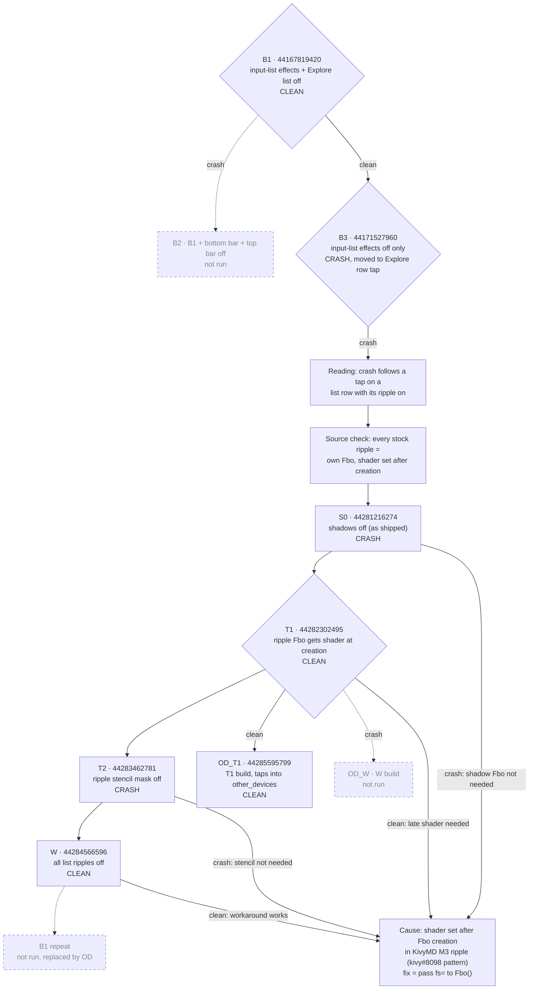

- [B1](https://github.com/AccelQuasarDragon/kivy-helper-repro/actions/runs/44167819420)
- [B3](https://github.com/AccelQuasarDragon/kivy-helper-repro/actions/runs/44171527960)

## Round 3b:​ the fix inside KivyMD \(Nov 19\-20\)

T1 patched the ripple from inside your app\. To test KivyMD itself, one cold build put three KivyMD versions into the same app \(shadows on\):​ C0 = master a00c10c, P1907 = PR \#1907, PRFS = our fork commit e0f0ca0 \(only the fix above\)\.

A second cold build did the same for a \~200\-line KivyMD\-only app \(none of your code\):​ mC0 and mPRFS\.

Results:​ the runs R1\-R4, D1\-D3, mC0, mPRFS below\.

- [controlP A/B build](https://github.com/AccelQuasarDragon/kivy-helper-repro/actions/runs/44580816339)
- [minimal app build](https://github.com/AccelQuasarDragon/kivy-helper-repro/actions/runs/44584005765)
- [minimal app source](https://github.com/AccelQuasarDragon/kivy-helper-repro/tree/main/stub_kivymd)
- [fork commit e0f0ca0](https://github.com/AccelQuasarDragon/KivyMD/commit/e0f0ca0c2c25a62d409543482e840bbd9133a3d8)
- [KivyMD PR \#1907](https://github.com/kivymd/KivyMD/pull/1907)
- [round 3 report \(Nov 18\)](https://accelquasardragon.github.io/kivy-helper-repro/shots/report-round3-2026-11-19/)

## Why other\_devices still crashes for you

Your commit sets ripple\_effect = False on MenuItem, InputItem and OtherDevicesView\.

MenuItem and InputItem are list items, so it works there\.

OtherDevicesView is an MDScreen, which has no ripple, so the line does nothing\.

Its 10 MDIconButtons and 2 MDSwitch thumbs keep their M3 ripples, and the entry button in the bottom bar ripples too\.

Two ways out:​ switch the ripple off for the whole app \(one patch of M3CommonRipple\), or use KivyMD with the fix \(R4:​ other\-devices taps clean\), which keeps the ripple\.

## Built from clean

Every APK here came from a cold build:​ a fresh GitHub runner with no cache \(cache=off\), so no old \.buildozer state\.

To do the same on your PC:​ delete the project's \.buildozer folder and bin/, then run buildozer android debug\.

## Limits

1 to 3 runs per variant\. The T1 clean result \(the app\-side patch\) is a single run; the KivyMD fork was clean 6 of 6 on two phones\.

Tested GPUs:​ Adreno 620 \(Pixel 5\) and Adreno 619 \(Galaxy A52\)\. Your Mi 9T has an Adreno 618:​ same driver family, not tested\.

The other\-devices taps never ran on the shipped build, so we did not reproduce your other\-devices crash ourselves\.

The phones ran in Firebase Test Lab with scripted taps and a fake device, not your Pioneer\.

Every APK passed an emulator tap\-path check first \(not listed, to keep the page short\)\.

Every published image and video was looked at first \(sampled frames, not every second\)\.

## Known gaps

1. CLOSED \(Nov 19, B0S\):​ the shipped ripple crashes on a shadows\-on build too, and on ANY first ripple \(the top\-bar power button\), not only list rows\.
2. PARTLY CLOSED \(Nov 20\):​ a second GPU, Adreno 619 \(D1 crash, D2 and D3 clean\)\. \#1900 also has Adreno 506 and 750, your Mi 9T an Adreno 618:​ untested\.
3. CLOSED \(Nov 19\-20\):​ the fix ran as KivyMD itself \(fork e0f0ca0\), not only as an app\-side patch:​ R2, R3, R4, D2, D3, mPRFS\.
4. tilt\_behavior\.py in KivyMD sets its shader the same late way and runs on Android; untested, follow\-up\.

## How to recreate

Each run below: its settings, step by step in the Actions tab, and the same as one gh command.

### Recreate run 44281216274

Run 44281216274 \(S0 shipped config, Pixel 5\)\.

These settings come from the report spec, not from the run itself\.

A new run tests the same APK artifact again on a lab phone:​ it reproduces the inputs, not that exact run\.

1. Open the device lab workflow in the Actions tab: [devicelab\.yml](https://github.com/AccelQuasarDragon/kivy-helper-repro/actions/workflows/devicelab.yml).
2. Click &quot;Run workflow&quot; \(top right of the run list\); keep the branch &quot;main&quot;\.
3. Set the field &quot;label&quot; to:​ `S0 shipped config, Pixel 5`
4. Set the field &quot;artifact\_run&quot; to:​ `44177064426`
5. Set the field &quot;artifact\_name&quot; to:​ `build-4-S0-a1`
6. Set the field &quot;taps&quot; to:​ `540,2000,5;540,600,8;540,800,8;540,360,8;540,360,10`
7. Leave every other field at its default\.
8. Click the green &quot;Run workflow&quot; button\.

Or with the GitHub CLI (`gh`):

```sh
gh workflow run devicelab.yml --repo AccelQuasarDragon/kivy-helper-repro --ref main --json <<'JSON'
{
 "label": "S0 shipped config, Pixel 5",
 "artifact_run": "44177064426",
 "artifact_name": "build-4-S0-a1",
 "taps": "540,2000,5;540,600,8;540,800,8;540,360,8;540,360,10"
}
JSON
```

### Recreate run 44282302495

Run 44282302495 \(T1 shader at Fbo creation\)\.

These settings come from the report spec, not from the run itself\.

A new run tests the same APK artifact again on a lab phone:​ it reproduces the inputs, not that exact run\.

1. Open the device lab workflow in the Actions tab: [devicelab\.yml](https://github.com/AccelQuasarDragon/kivy-helper-repro/actions/workflows/devicelab.yml).
2. Click &quot;Run workflow&quot; \(top right of the run list\); keep the branch &quot;main&quot;\.
3. Set the field &quot;label&quot; to:​ `T1 shader at Fbo creation`
4. Set the field &quot;artifact\_run&quot; to:​ `44185768900`
5. Set the field &quot;artifact\_name&quot; to:​ `build-5-T1-a1`
6. Set the field &quot;taps&quot; to:​ `540,2000,5;540,600,8;540,800,8;540,360,8;540,360,10`
7. Leave every other field at its default\.
8. Click the green &quot;Run workflow&quot; button\.

Or with the GitHub CLI (`gh`):

```sh
gh workflow run devicelab.yml --repo AccelQuasarDragon/kivy-helper-repro --ref main --json <<'JSON'
{
 "label": "T1 shader at Fbo creation",
 "artifact_run": "44185768900",
 "artifact_name": "build-5-T1-a1",
 "taps": "540,2000,5;540,600,8;540,800,8;540,360,8;540,360,10"
}
JSON
```

### Recreate run 44283462781

Run 44283462781 \(T2 ripple without stencil\)\.

These settings come from the report spec, not from the run itself\.

A new run tests the same APK artifact again on a lab phone:​ it reproduces the inputs, not that exact run\.

1. Open the device lab workflow in the Actions tab: [devicelab\.yml](https://github.com/AccelQuasarDragon/kivy-helper-repro/actions/workflows/devicelab.yml).
2. Click &quot;Run workflow&quot; \(top right of the run list\); keep the branch &quot;main&quot;\.
3. Set the field &quot;label&quot; to:​ `T2 ripple without stencil`
4. Set the field &quot;artifact\_run&quot; to:​ `44185768900`
5. Set the field &quot;artifact\_name&quot; to:​ `build-5-T2-a1`
6. Set the field &quot;taps&quot; to:​ `540,2000,5;540,600,8;540,800,8;540,360,8;540,360,10`
7. Leave every other field at its default\.
8. Click the green &quot;Run workflow&quot; button\.

Or with the GitHub CLI (`gh`):

```sh
gh workflow run devicelab.yml --repo AccelQuasarDragon/kivy-helper-repro --ref main --json <<'JSON'
{
 "label": "T2 ripple without stencil",
 "artifact_run": "44185768900",
 "artifact_name": "build-5-T2-a1",
 "taps": "540,2000,5;540,600,8;540,800,8;540,360,8;540,360,10"
}
JSON
```

### Recreate run 44284566596

Run 44284566596 \(W list ripples off\)\.

These settings come from the report spec, not from the run itself\.

A new run tests the same APK artifact again on a lab phone:​ it reproduces the inputs, not that exact run\.

1. Open the device lab workflow in the Actions tab: [devicelab\.yml](https://github.com/AccelQuasarDragon/kivy-helper-repro/actions/workflows/devicelab.yml).
2. Click &quot;Run workflow&quot; \(top right of the run list\); keep the branch &quot;main&quot;\.
3. Set the field &quot;label&quot; to:​ `W list ripples off`
4. Set the field &quot;artifact\_run&quot; to:​ `44185768900`
5. Set the field &quot;artifact\_name&quot; to:​ `build-5-W-a1`
6. Set the field &quot;taps&quot; to:​ `540,2000,5;540,600,8;540,800,8;540,360,8;540,360,10`
7. Leave every other field at its default\.
8. Click the green &quot;Run workflow&quot; button\.

Or with the GitHub CLI (`gh`):

```sh
gh workflow run devicelab.yml --repo AccelQuasarDragon/kivy-helper-repro --ref main --json <<'JSON'
{
 "label": "W list ripples off",
 "artifact_run": "44185768900",
 "artifact_name": "build-5-W-a1",
 "taps": "540,2000,5;540,600,8;540,800,8;540,360,8;540,360,10"
}
JSON
```

### Recreate run 44285595799

Run 44285595799 \(OD other devices, T1 build\)\.

These settings come from the report spec, not from the run itself\.

A new run tests the same APK artifact again on a lab phone:​ it reproduces the inputs, not that exact run\.

1. Open the device lab workflow in the Actions tab: [devicelab\.yml](https://github.com/AccelQuasarDragon/kivy-helper-repro/actions/workflows/devicelab.yml).
2. Click &quot;Run workflow&quot; \(top right of the run list\); keep the branch &quot;main&quot;\.
3. Set the field &quot;label&quot; to:​ `OD other devices, T1 build`
4. Set the field &quot;artifact\_run&quot; to:​ `44185768900`
5. Set the field &quot;artifact\_name&quot; to:​ `build-5-T1-a1`
6. Set the field &quot;taps&quot; to:​ `540,2000,5;540,600,8;996,2229,8;876,288,5;868,434,5;868,434,5;876,672,8`
7. Leave every other field at its default\.
8. Click the green &quot;Run workflow&quot; button\.

Or with the GitHub CLI (`gh`):

```sh
gh workflow run devicelab.yml --repo AccelQuasarDragon/kivy-helper-repro --ref main --json <<'JSON'
{
 "label": "OD other devices, T1 build",
 "artifact_run": "44185768900",
 "artifact_name": "build-5-T1-a1",
 "taps": "540,2000,5;540,600,8;996,2229,8;876,288,5;868,434,5;868,434,5;876,672,8"
}
JSON
```

### Recreate run 44501582277

Run 44501582277 \(B0S shipped ripple, shadows on\)\.

These settings come from the report spec, not from the run itself\.

A new run tests the same APK artifact again on a lab phone:​ it reproduces the inputs, not that exact run\.

1. Open the device lab workflow in the Actions tab: [devicelab\.yml](https://github.com/AccelQuasarDragon/kivy-helper-repro/actions/workflows/devicelab.yml).
2. Click &quot;Run workflow&quot; \(top right of the run list\); keep the branch &quot;main&quot;\.
3. Set the field &quot;label&quot; to:​ `B0S power then row`
4. Set the field &quot;artifact\_run&quot; to:​ `44324237484`
5. Set the field &quot;artifact\_name&quot; to:​ `build-6-B0S-a1`
6. Set the field &quot;taps&quot; to:​ `540,2000,5;540,600,8;1000,232,8;540,800,8;540,800,8`
7. Leave every other field at its default\.
8. Click the green &quot;Run workflow&quot; button\.

Or with the GitHub CLI (`gh`):

```sh
gh workflow run devicelab.yml --repo AccelQuasarDragon/kivy-helper-repro --ref main --json <<'JSON'
{
 "label": "B0S power then row",
 "artifact_run": "44324237484",
 "artifact_name": "build-6-B0S-a1",
 "taps": "540,2000,5;540,600,8;1000,232,8;540,800,8;540,800,8"
}
JSON
```

### Recreate run 44589140589

Run 44589140589 \(R1 KivyMD PR \#1907\)\.

These settings come from the report spec, not from the run itself\.

A new run tests the same APK artifact again on a lab phone:​ it reproduces the inputs, not that exact run\.

1. Open the device lab workflow in the Actions tab: [devicelab\.yml](https://github.com/AccelQuasarDragon/kivy-helper-repro/actions/workflows/devicelab.yml).
2. Click &quot;Run workflow&quot; \(top right of the run list\); keep the branch &quot;main&quot;\.
3. Set the field &quot;label&quot; to:​ `R1 P1907 taps A`
4. Set the field &quot;artifact\_run&quot; to:​ `44580816339`
5. Set the field &quot;artifact\_name&quot; to:​ `build-7-P1907-a1`
6. Set the field &quot;taps&quot; to:​ `540,2000,5;540,600,8;1000,232,8;1000,232,8;540,800,8;1000,232,8;1000,232,8`
7. Leave every other field at its default\.
8. Click the green &quot;Run workflow&quot; button\.

Or with the GitHub CLI (`gh`):

```sh
gh workflow run devicelab.yml --repo AccelQuasarDragon/kivy-helper-repro --ref main --json <<'JSON'
{
 "label": "R1 P1907 taps A",
 "artifact_run": "44580816339",
 "artifact_name": "build-7-P1907-a1",
 "taps": "540,2000,5;540,600,8;1000,232,8;1000,232,8;540,800,8;1000,232,8;1000,232,8"
}
JSON
```

### Recreate run 44590309751

Run 44590309751 \(R2 KivyMD fs= fix, power x2\)\.

These settings come from the report spec, not from the run itself\.

A new run tests the same APK artifact again on a lab phone:​ it reproduces the inputs, not that exact run\.

1. Open the device lab workflow in the Actions tab: [devicelab\.yml](https://github.com/AccelQuasarDragon/kivy-helper-repro/actions/workflows/devicelab.yml).
2. Click &quot;Run workflow&quot; \(top right of the run list\); keep the branch &quot;main&quot;\.
3. Set the field &quot;label&quot; to:​ `R2 PRFS taps A`
4. Set the field &quot;artifact\_run&quot; to:​ `44580816339`
5. Set the field &quot;artifact\_name&quot; to:​ `build-7-PRFS-a1`
6. Set the field &quot;taps&quot; to:​ `540,2000,5;540,600,8;1000,232,8;1000,232,8;540,800,8;1000,232,8;1000,232,8`
7. Leave every other field at its default\.
8. Click the green &quot;Run workflow&quot; button\.

Or with the GitHub CLI (`gh`):

```sh
gh workflow run devicelab.yml --repo AccelQuasarDragon/kivy-helper-repro --ref main --json <<'JSON'
{
 "label": "R2 PRFS taps A",
 "artifact_run": "44580816339",
 "artifact_name": "build-7-PRFS-a1",
 "taps": "540,2000,5;540,600,8;1000,232,8;1000,232,8;540,800,8;1000,232,8;1000,232,8"
}
JSON
```

### Recreate run 44591562998

Run 44591562998 \(R3 fs= fix, list row x3\)\.

These settings come from the report spec, not from the run itself\.

A new run tests the same APK artifact again on a lab phone:​ it reproduces the inputs, not that exact run\.

1. Open the device lab workflow in the Actions tab: [devicelab\.yml](https://github.com/AccelQuasarDragon/kivy-helper-repro/actions/workflows/devicelab.yml).
2. Click &quot;Run workflow&quot; \(top right of the run list\); keep the branch &quot;main&quot;\.
3. Set the field &quot;label&quot; to:​ `R3 PRFS taps B`
4. Set the field &quot;artifact\_run&quot; to:​ `44580816339`
5. Set the field &quot;artifact\_name&quot; to:​ `build-7-PRFS-a1`
6. Set the field &quot;taps&quot; to:​ `540,2000,5;540,600,8;540,800,8;1000,232,8;540,800,8;1000,232,8;540,800,10`
7. Leave every other field at its default\.
8. Click the green &quot;Run workflow&quot; button\.

Or with the GitHub CLI (`gh`):

```sh
gh workflow run devicelab.yml --repo AccelQuasarDragon/kivy-helper-repro --ref main --json <<'JSON'
{
 "label": "R3 PRFS taps B",
 "artifact_run": "44580816339",
 "artifact_name": "build-7-PRFS-a1",
 "taps": "540,2000,5;540,600,8;540,800,8;1000,232,8;540,800,8;1000,232,8;540,800,10"
}
JSON
```

### Recreate run 44592679382

Run 44592679382 \(R4 fs= fix, other devices\)\.

These settings come from the report spec, not from the run itself\.

A new run tests the same APK artifact again on a lab phone:​ it reproduces the inputs, not that exact run\.

1. Open the device lab workflow in the Actions tab: [devicelab\.yml](https://github.com/AccelQuasarDragon/kivy-helper-repro/actions/workflows/devicelab.yml).
2. Click &quot;Run workflow&quot; \(top right of the run list\); keep the branch &quot;main&quot;\.
3. Set the field &quot;label&quot; to:​ `R4 PRFS other devices`
4. Set the field &quot;artifact\_run&quot; to:​ `44580816339`
5. Set the field &quot;artifact\_name&quot; to:​ `build-7-PRFS-a1`
6. Set the field &quot;taps&quot; to:​ `540,2000,5;540,600,8;996,2229,8;876,288,5;868,434,5;868,434,5;876,672,8`
7. Leave every other field at its default\.
8. Click the green &quot;Run workflow&quot; button\.

Or with the GitHub CLI (`gh`):

```sh
gh workflow run devicelab.yml --repo AccelQuasarDragon/kivy-helper-repro --ref main --json <<'JSON'
{
 "label": "R4 PRFS other devices",
 "artifact_run": "44580816339",
 "artifact_name": "build-7-PRFS-a1",
 "taps": "540,2000,5;540,600,8;996,2229,8;876,288,5;868,434,5;868,434,5;876,672,8"
}
JSON
```

### Recreate run 44716239758

Run 44716239758 \(D1 shipped ripple, Galaxy A52\)\.

These settings come from the report spec, not from the run itself\.

A new run tests the same APK artifact again on a lab phone:​ it reproduces the inputs, not that exact run\.

1. Open the device lab workflow in the Actions tab: [devicelab\.yml](https://github.com/AccelQuasarDragon/kivy-helper-repro/actions/workflows/devicelab.yml).
2. Click &quot;Run workflow&quot; \(top right of the run list\); keep the branch &quot;main&quot;\.
3. Set the field &quot;label&quot; to:​ `D1 C0 Galaxy A52`
4. Set the field &quot;artifact\_run&quot; to:​ `44580816339`
5. Set the field &quot;artifact\_name&quot; to:​ `build-7-C0-a1`
6. Set the field &quot;taps&quot; to:​ `540,2000,5;540,600,8;540,800,8;540,800,8`
7. Set the field &quot;device&quot; to:​ `a52xq`
8. Set the field &quot;version&quot; to:​ `34`
9. Leave every other field at its default\.
10. Click the green &quot;Run workflow&quot; button\.

Or with the GitHub CLI (`gh`):

```sh
gh workflow run devicelab.yml --repo AccelQuasarDragon/kivy-helper-repro --ref main --json <<'JSON'
{
 "label": "D1 C0 Galaxy A52",
 "artifact_run": "44580816339",
 "artifact_name": "build-7-C0-a1",
 "taps": "540,2000,5;540,600,8;540,800,8;540,800,8",
 "device": "a52xq",
 "version": "34"
}
JSON
```

### Recreate run 44717304020

Run 44717304020 \(D2 fs= fix, Galaxy A52\)\.

These settings come from the report spec, not from the run itself\.

A new run tests the same APK artifact again on a lab phone:​ it reproduces the inputs, not that exact run\.

1. Open the device lab workflow in the Actions tab: [devicelab\.yml](https://github.com/AccelQuasarDragon/kivy-helper-repro/actions/workflows/devicelab.yml).
2. Click &quot;Run workflow&quot; \(top right of the run list\); keep the branch &quot;main&quot;\.
3. Set the field &quot;label&quot; to:​ `D2 PRFS Galaxy A52`
4. Set the field &quot;artifact\_run&quot; to:​ `44580816339`
5. Set the field &quot;artifact\_name&quot; to:​ `build-7-PRFS-a1`
6. Set the field &quot;taps&quot; to:​ `540,2000,5;540,600,8;540,800,8;540,800,8`
7. Set the field &quot;device&quot; to:​ `a52xq`
8. Set the field &quot;version&quot; to:​ `34`
9. Leave every other field at its default\.
10. Click the green &quot;Run workflow&quot; button\.

Or with the GitHub CLI (`gh`):

```sh
gh workflow run devicelab.yml --repo AccelQuasarDragon/kivy-helper-repro --ref main --json <<'JSON'
{
 "label": "D2 PRFS Galaxy A52",
 "artifact_run": "44580816339",
 "artifact_name": "build-7-PRFS-a1",
 "taps": "540,2000,5;540,600,8;540,800,8;540,800,8",
 "device": "a52xq",
 "version": "34"
}
JSON
```

### Recreate run 44718163639

Run 44718163639 \(D3 fs= fix, Galaxy A52, repeat\)\.

These settings come from the report spec, not from the run itself\.

A new run tests the same APK artifact again on a lab phone:​ it reproduces the inputs, not that exact run\.

1. Open the device lab workflow in the Actions tab: [devicelab\.yml](https://github.com/AccelQuasarDragon/kivy-helper-repro/actions/workflows/devicelab.yml).
2. Click &quot;Run workflow&quot; \(top right of the run list\); keep the branch &quot;main&quot;\.
3. Set the field &quot;label&quot; to:​ `D3 PRFS Galaxy A52 repeat`
4. Set the field &quot;artifact\_run&quot; to:​ `44580816339`
5. Set the field &quot;artifact\_name&quot; to:​ `build-7-PRFS-a1`
6. Set the field &quot;taps&quot; to:​ `540,2000,5;540,600,8;540,800,8;540,800,8`
7. Set the field &quot;device&quot; to:​ `a52xq`
8. Set the field &quot;version&quot; to:​ `34`
9. Leave every other field at its default\.
10. Click the green &quot;Run workflow&quot; button\.

Or with the GitHub CLI (`gh`):

```sh
gh workflow run devicelab.yml --repo AccelQuasarDragon/kivy-helper-repro --ref main --json <<'JSON'
{
 "label": "D3 PRFS Galaxy A52 repeat",
 "artifact_run": "44580816339",
 "artifact_name": "build-7-PRFS-a1",
 "taps": "540,2000,5;540,600,8;540,800,8;540,800,8",
 "device": "a52xq",
 "version": "34"
}
JSON
```

### Recreate run 44719013412

Run 44719013412 \(mC0 minimal app, shipped ripple\)\.

These settings come from the report spec, not from the run itself\.

A new run tests the same APK artifact again on a lab phone:​ it reproduces the inputs, not that exact run\.

1. Open the device lab workflow in the Actions tab: [devicelab\.yml](https://github.com/AccelQuasarDragon/kivy-helper-repro/actions/workflows/devicelab.yml).
2. Click &quot;Run workflow&quot; \(top right of the run list\); keep the branch &quot;main&quot;\.
3. Set the field &quot;label&quot; to:​ `mC0 minimal app`
4. Set the field &quot;artifact\_run&quot; to:​ `44584005765`
5. Set the field &quot;artifact\_name&quot; to:​ `build-8-mC0-a1`
6. Set the field &quot;taps&quot; to:​ `540,2000,5;1000,232,8;540,1735,8;540,900,6;540,900,6;1000,232,8;540,1735,8`
7. Leave every other field at its default\.
8. Click the green &quot;Run workflow&quot; button\.

Or with the GitHub CLI (`gh`):

```sh
gh workflow run devicelab.yml --repo AccelQuasarDragon/kivy-helper-repro --ref main --json <<'JSON'
{
 "label": "mC0 minimal app",
 "artifact_run": "44584005765",
 "artifact_name": "build-8-mC0-a1",
 "taps": "540,2000,5;1000,232,8;540,1735,8;540,900,6;540,900,6;1000,232,8;540,1735,8"
}
JSON
```

### Recreate run 44719993437

Run 44719993437 \(mPRFS minimal app, fs= fix\)\.

These settings come from the report spec, not from the run itself\.

A new run tests the same APK artifact again on a lab phone:​ it reproduces the inputs, not that exact run\.

1. Open the device lab workflow in the Actions tab: [devicelab\.yml](https://github.com/AccelQuasarDragon/kivy-helper-repro/actions/workflows/devicelab.yml).
2. Click &quot;Run workflow&quot; \(top right of the run list\); keep the branch &quot;main&quot;\.
3. Set the field &quot;label&quot; to:​ `mPRFS minimal app`
4. Set the field &quot;artifact\_run&quot; to:​ `44584005765`
5. Set the field &quot;artifact\_name&quot; to:​ `build-8-mPRFS-a1`
6. Set the field &quot;taps&quot; to:​ `540,2000,5;1000,232,8;540,1735,8;540,900,6;540,900,6;1000,232,8;540,1735,8`
7. Leave every other field at its default\.
8. Click the green &quot;Run workflow&quot; button\.

Or with the GitHub CLI (`gh`):

```sh
gh workflow run devicelab.yml --repo AccelQuasarDragon/kivy-helper-repro --ref main --json <<'JSON'
{
 "label": "mPRFS minimal app",
 "artifact_run": "44584005765",
 "artifact_name": "build-8-mPRFS-a1",
 "taps": "540,2000,5;1000,232,8;540,1735,8;540,900,6;540,900,6;1000,232,8;540,1735,8"
}
JSON
```
